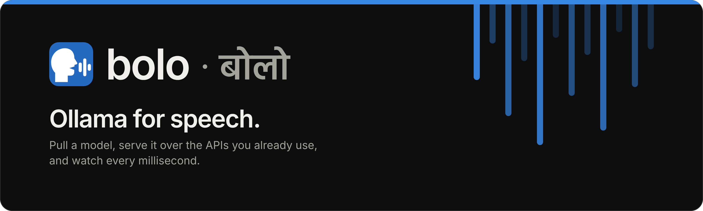
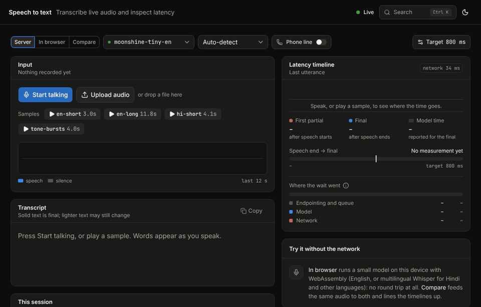
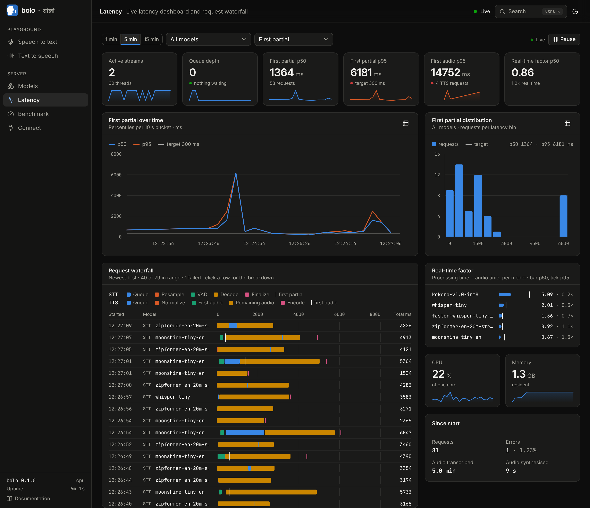
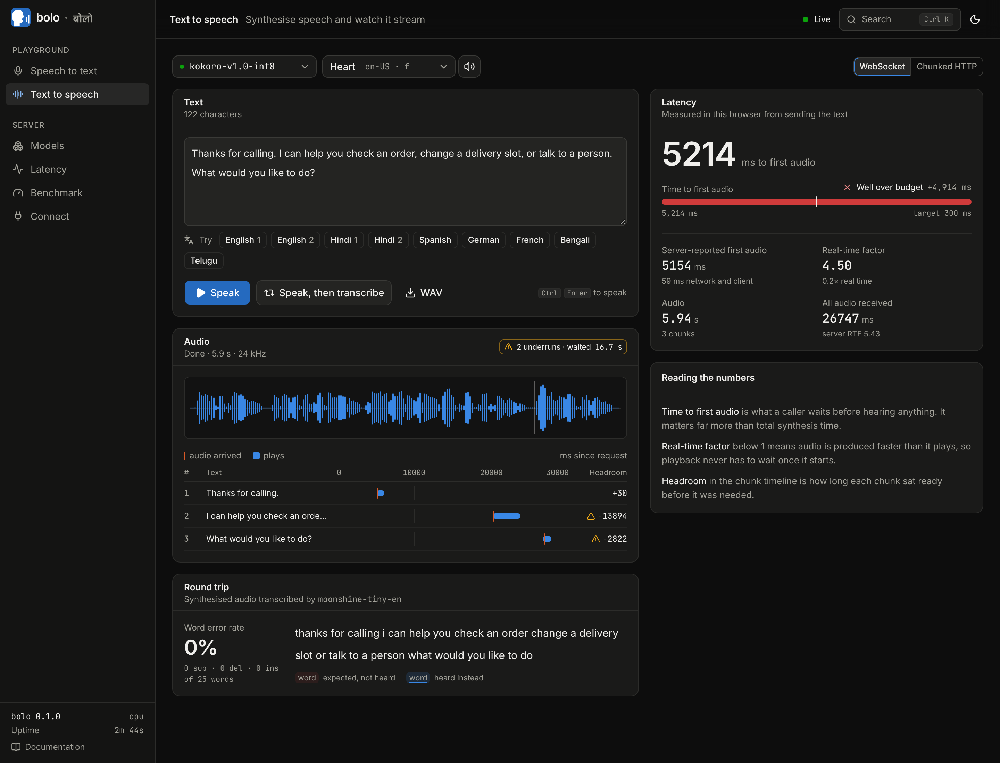
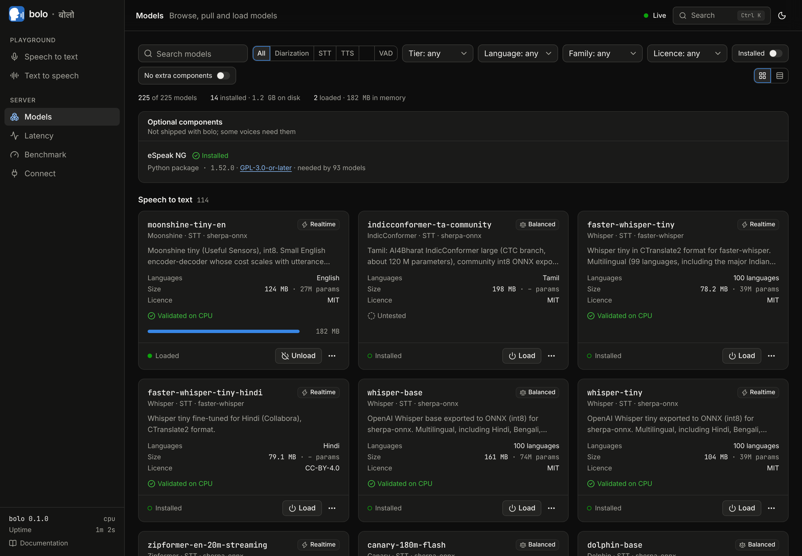
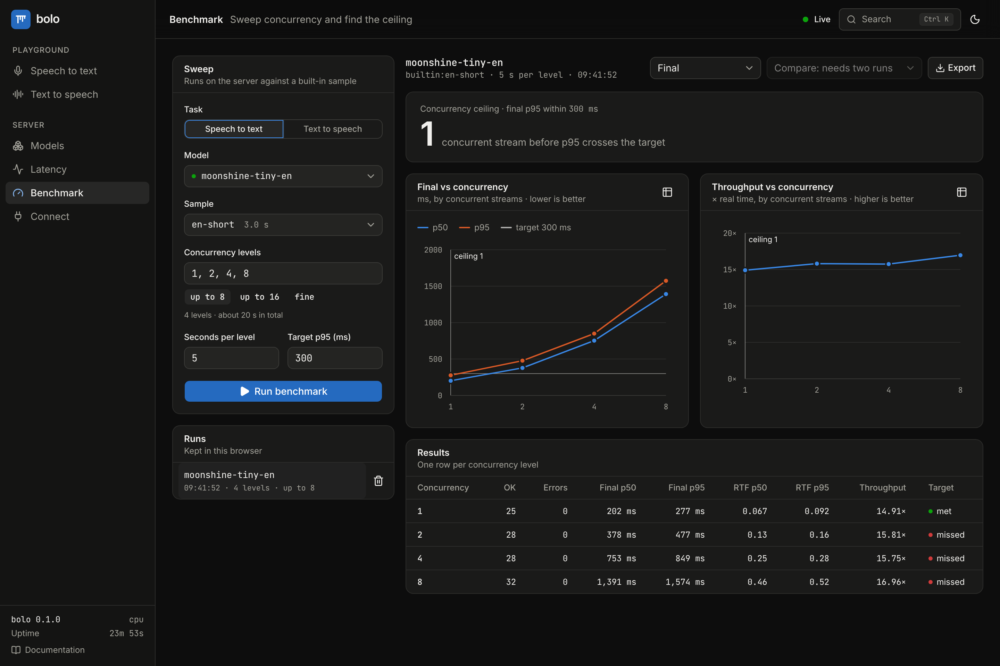

<p align="center">
  <a href="https://cb-sigma.github.io/bolo/">
    <picture>
      <source media="(prefers-color-scheme: dark)" srcset="docs/assets/brand/banner-dark.png">
      <source media="(prefers-color-scheme: light)" srcset="docs/assets/brand/banner-light.png">
      
    </picture>
  </a>
</p>

<p align="center">
  <a href="https://github.com/cb-Sigma/bolo/actions/workflows/ci.yml"></a>
  <a href="LICENSE"></a>
  <a href="https://github.com/cb-Sigma/bolo/actions/workflows/pages.yml"></a>
  <a href="https://cb-sigma.github.io/bolo/"></a>
  
  
</p>

**bolo is a speech server you run yourself: it pulls speech models by name and serves speech-to-text, text-to-speech, speaker diarization and whole voice agents over the APIs your clients already use.** It speaks the OpenAI audio and Realtime APIs, the speaches routes and the Wyoming protocol; runs a catalog of a few hundred models on ONNX Runtime and CTranslate2 without PyTorch; puts cloud speech APIs behind the same routes when you want them; answers phone calls; and traces every request phase by phase. One Python process, CPU first, Apache-2.0.

*bolo* (बोलो) is Hindi for "speak".

<p align="center">
  <a href="https://cb-sigma.github.io/bolo/"></a>
</p>

<p align="center">
  <sub>The demo runs speech recognition entirely in your browser with WebAssembly: no install, no upload.</sub>
</p>

<p align="center">
  
</p>

<p align="center">
  <sub>The speech-to-text playground, live against a real server on a 4-core CPU. Lighter text is still changing; solid text is final.</sub>
</p>

> **Status: alpha.** Developed and measured on Linux x86-64, CPU only; CI also runs the test suite on Windows (CPU). GPUs, Apple Silicon and arm64 are untested, and so is anything on Windows beyond the tests; the phone and cloud integrations have not met a real account. [What has not been validated](#what-has-not-been-validated) says so plainly.

## Install

```bash
uv tool install "bolo-speech[all]"        # with uv (https://docs.astral.sh/uv/)
bolo serve
```

The double quotes work in bash, zsh, PowerShell and cmd (cmd.exe does not treat single quotes as quotes).

- Run it once without installing: `uvx --from "bolo-speech[all]" bolo serve`.
- Without uv: `pipx install "bolo-speech[all]"`, or `pip install "bolo-speech[all]"` into a virtual environment.
- With Homebrew (macOS 14 or later, Linux): `brew install cb-sigma/tap/bolo`, then `brew services start bolo` to run it in the background (console at http://127.0.0.1:8000/). It installs `all`; the [tap's README](https://github.com/cB-Sigma/homebrew-tap#bolo) shows how to add the opt-in extras.
- On Windows (PowerShell or cmd), the same command. Models go to `%USERPROFILE%\.cache\bolo`; DirectML, services and the other differences: [docs/configuration.md](docs/configuration.md#windows).
- With an NVIDIA GPU on Windows: `uv tool install "bolo-speech[all,cuda]"`, then swap `onnxruntime` for `onnxruntime-gpu[cuda,cudnn]` in the tool's environment (`uv pip uninstall --python <tool python> onnxruntime`, then `uv pip install --python <tool python> "onnxruntime-gpu[cuda,cudnn]" nvidia-cublas-cu12 "nvidia-cudnn-cu12>=9,<10"`, about 2.5 GB for CUDA 12 and 13) and set `BOLO_DEVICE=cuda`; `bolo doctor` loads both CUDA runtimes and names what is missing. faster-whisper is the GPU route for speech-to-text there (sherpa-onnx's CUDA build cannot run inside bolo on Windows). The recipe: [CUDA on Windows](docs/configuration.md#cuda-on-windows).
- As a container (CPU image): `docker run -p 8000:8000 -v bolo-data:/data ghcr.io/cb-sigma/bolo:latest`. Compose, systemd and Kubernetes examples, and what was run of each: [deploy/README.md](deploy/README.md).

The PyPI distribution is `bolo-speech`; the command and the Python package are `bolo`. Python 3.10 or newer.

The base install has no engine at all; extras add what you want. `all` is `sherpa` (most models), `faster-whisper`, `uccharan` (phonemes and text normalisation), `av` (M4A/WebM/AAC through bundled FFmpeg) and `wyoming`. Opt-in extras: `webrtc`, `turn` (end-of-turn model), `orpheus`, `s2s` (in-process speech-to-speech), `sip`, `moonshine`, `whispercpp`, `cuda` (CUDA 12's cuBLAS and cuDNN for faster-whisper on an NVIDIA GPU, Windows and Linux), and `espeak` (eSpeak NG, GPL-3.0-or-later, never part of `all`; see [Licences](#licences)).

## Quick start

Open <http://127.0.0.1:8000> for the console, or use the API. The first request for a model downloads it:

```bash
# speech to text (pulls whisper-base, about 160 MB, the first time)
curl http://127.0.0.1:8000/v1/audio/transcriptions -F file=@recording.wav -F model=whisper-1

# text to speech (pulls kokoro-v1.0-int8, about 170 MB, the first time)
curl http://127.0.0.1:8000/v1/audio/speech -H 'Content-Type: application/json' \
  -d '{"model": "tts-1", "voice": "af_heart", "input": "Hello from bolo."}' -o hello.mp3
```

In PowerShell (in Windows PowerShell 5.1 `curl` is `Invoke-WebRequest`, so call `curl.exe`):

```powershell
curl.exe http://127.0.0.1:8000/v1/audio/transcriptions -F file=@recording.wav -F model=whisper-1
$body = @{ model = "tts-1"; voice = "af_heart"; input = "Hello from bolo." } | ConvertTo-Json
Invoke-RestMethod http://127.0.0.1:8000/v1/audio/speech -Method Post -ContentType "application/json; charset=utf-8" `
  -Body ([Text.Encoding]::UTF8.GetBytes($body)) -OutFile hello.mp3      # UTF-8 bytes: any language's text survives
```

Windows PowerShell 5.1 drops the double quotes inside an argument it passes to a program, so `curl.exe -d '{"model": ...}'` sends broken JSON there: use `Invoke-RestMethod` as above, or `curl.exe ... -d "@body.json"` (PowerShell 7.3 and later pass them as written). Piping a program's UTF-8 output on in 5.1 needs `[Console]::OutputEncoding = [Text.Encoding]::UTF8` first. In cmd, JSON needs escaped double quotes: `curl.exe ... -H "Content-Type: application/json" -d "{\"model\": \"tts-1\", \"voice\": \"af_heart\", \"input\": \"Hello from bolo.\"}" -o hello.mp3`. Environment variables are `$env:BOLO_DEVICE = "cuda"` in PowerShell and `set BOLO_DEVICE=cuda` in cmd.

With the official OpenAI SDK, only the base URL changes:

```python
from openai import OpenAI

client = OpenAI(base_url="http://127.0.0.1:8000/v1", api_key="not-needed")
text = client.audio.transcriptions.create(model="whisper-1", file=open("recording.wav", "rb")).text
client.audio.speech.create(model="tts-1", voice="alloy", input=text).write_to_file("echo.mp3")
```

Or choose models yourself:

```bash
bolo recommend                    # which models suit this machine (advice only: nothing is restricted)
bolo list --all -q english        # browse the catalog
bolo pull moonshine-tiny-en       # 124 MB, the fastest English recogniser here
bolo transcribe recording.wav -m moonshine-tiny-en
bolo speak "Hello there." -o hello.wav -m kokoro-v1.0-int8 --voice af_heart
bolo ps                           # what a running server has in memory: size, CPU/GPU, time until unload
bolo show kokoro-v1.0-int8        # licence, files, settings, voices, speed (`bolo list`, `rm`, `cp` as in Ollama)
bolo logs -f                      # the server's log file, when it writes one (log_file)
bolo doctor                       # engines, codecs, components, this machine, where the logs are
```

For a voice agent, point bolo at any OpenAI-compatible language model and connect a Realtime client to `ws://127.0.0.1:8000/v1/realtime` (or open the console's Conversation page):

```bash
bolo serve --llm-base-url http://127.0.0.1:11434/v1 --llm-model llama3.2      # Ollama, for example
```

More clients (curl, Python, Node, WebSockets, Pipecat, LiveKit Agents, Wyoming): [examples/](examples/).

## What it does

| | | More |
| --- | --- | --- |
| **OpenAI-compatible speech APIs** | `/v1/audio/transcriptions` (json, text, srt, vtt, verbose_json with word timestamps, SSE), translations, `/v1/audio/speech` (mp3, opus, aac, flac, wav, pcm, G.711; streamed as it is synthesised), `/v1/models`. OpenAI model and voice names map to your defaults. Also the model-management routes and environment variables of [speaches](https://github.com/speaches-ai/speaches), and streaming WebSockets for both directions | [api.md](docs/api.md), [migration-from-speaches.md](docs/migration-from-speaches.md) |
| **Realtime speech-to-text** | true streaming models, and stabilised partial results for models that were never designed to stream; endpointing you can tune | [realtime.md](docs/realtime.md) |
| **Voice agents, three pipelines** | the OpenAI Realtime API (`WS /v1/realtime`, WebRTC at `/v1/realtime/calls`) and audio in `/v1/chat/completions`, with turn detection, barge-in, tools and per-turn traces. `cascade`: bolo's recogniser → your language model → bolo's voice. `audio-llm`: a model that hears the audio itself, bolo speaks. `speech-to-speech`: one model hears and speaks, behind a llama-server, a cloud Realtime API, or **in bolo's own process** (`lfm3-audio-2b-onnx`) | [voice-agents.md](docs/voice-agents.md) |
| **Phone calls** | Twilio Media Streams, Plivo audio streams, Telnyx media streaming and the Exotel Voicebot applet connected to named agents; an experimental inbound SIP endpoint. Greeting, barge-in, key presses, hang-up and transfer, outbound calls with voicemail handling, signed webhooks, call records with a latency breakdown, a call simulator | [telephony.md](docs/telephony.md) |
| **Cloud providers next to local models** | OpenAI, Sarvam, ElevenLabs, Deepgram or any OpenAI-compatible server behind the same routes, with bolo's diarization, word lists, telephony formats, traces and cost estimates on top, and **fallback** between local and cloud models in either direction. Audio leaves the server only when you name such a model | [providers.md](docs/providers.md) |
| **Who said what** | speaker diarization without PyTorch (pyannote segmentation with speaker embeddings, or NVIDIA's overlap-aware Nemotron), as `diarized_json`, in subtitles, on words and on live transcripts; known speakers named from reference recordings. **Speaker-attributed recognition**: DiCoW transcribes each speaker of a conversation separately, overlaps included, in the core (`dicow-v3.3-onnx`) or through the torch plugin | [models.md](docs/models.md#speaker-diarization-1) |
| **Voice cloning with a voice library** | save a person's voice once (cleaned, checked, **consent required** and recorded), then name it as the `voice` of any cloning model, OpenAI's custom-voice shape included; cloned speech is labelled; a speaker-similarity score, calibrated on real speech, says how alike the clone is; Tontaube, Chatterbox, Qwen3-TTS, Pocket TTS and more | [voices.md](docs/voices.md) |
| **A model catalog** | pull by name, with licences and gating on every entry and what was actually measured; `hf:owner/repo`, any Piper voice by name, local directories and URLs for everything else | [models.md](docs/models.md), [below](#models-and-licences) |
| **Hardware-aware recommendations** | bolo looks at the machine and rates every model for it; it recommends and warns, and never hides or refuses a model | [recommendations.md](docs/recommendations.md) |
| **Text preparation** | numbers, dates, money, units and URLs read out in the voice's language; pronunciation word lists for names and jargon; an SSML subset; romanised input ("mujhe kal jana hai") written in the voice's script; phonemes without the GPL through [uccharan](https://github.com/cb-Sigma/uccharan) | [api.md](docs/api.md#text-preparation-ssml-and-pronunciation-word-lists), [models.md](docs/models.md#phonemisers) |
| **Indian languages** | recognition for all 22 scheduled languages, voices for 15 of them and for Bhojpuri, Magahi and Chhattisgarhi, 8 kHz G.711 in and out | [indic-telephony.md](docs/indic-telephony.md) |
| **A web console** | playgrounds, the catalog, latency dashboards, benchmarks, conversations, calls, served by the same process | [below](#the-console) |
| **Engine plugins** | models that need another runtime run out of process behind the same API: [bolo-torch](plugins/bolo-torch/README.md) for PyTorch models | [plugins.md](docs/plugins.md) |
| **Wyoming** | speech-to-text and text-to-speech for Home Assistant on one TCP port | [api.md](docs/api.md#wyoming-protocol), [examples/home_assistant.md](examples/home_assistant.md) |
| **Ollama-style model scheduling** | each model goes on the GPU when it fits in free VRAM and on the CPU when it does not (llama.cpp models split by layers, ONNX models by graph or cut in two at a layer boundary); several GPUs (`gpus`, `gpu_spread`, `--tensor-split` for llama.cpp); `keep_alive` per request, `num_parallel` and `max_queue` per model, flash attention and a quantized KV cache for llama.cpp voices; `bolo ps` with size, CPU/GPU split, GPU and time until unload, `bolo load` / `stop` / `show` / `rm` / `cp` (presets) / `logs`, a "Loaded models" panel in the console; `OLLAMA_*` variables mapped. GPU side tested with fakes only | [configuration.md](docs/configuration.md#gpu-and-cpu-placement), [coming from Ollama](docs/configuration.md#coming-from-ollama), [api.md](docs/api.md#keep-alive) |
| **Server behaviour** | per-model queues with micro-batching, backpressure (`429`, not a growing delay), cancellation, lazy loading, idle unloading, a memory budget, resumable verified downloads, Prometheus metrics, and a phase-by-phase trace of every request | [architecture.md](docs/architecture.md), [configuration.md](docs/configuration.md) |

## Models and licences

<!-- BEGIN GENERATED: models-summary -->
| Task | Family | Models | Languages | Validated on CPU | Best measured RTF |
| --- | --- | --- | --- | --- | --- |
| STT | OpenAI (cloud) | 4 | af, am, ar, as, az, ba, be, bg +92 | 0 | - |
| TTS | OpenAI (cloud) | 3 | af, am, ar, as, az, ba, be, bg +92 | 0 | - |
| STT | Sarvam (cloud) | 3 | as, bn, brx, doi, en, gu, hi, kn +15 | 0 | - |
| TTS | Sarvam (cloud) | 3 | bn, en, gu, hi, kn, ml, mr, or +3 | 0 | - |
| TTS | ElevenLabs (cloud) | 3 | ar, bg, cs, da, de, el, en, es +24 | 0 | - |
| STT | ElevenLabs (cloud) | 2 | af, am, ar, as, az, ba, be, bg +92 | 0 | - |
| STT | Deepgram (cloud) | 2 | af, ar, as, be, bg, bn, bs, ca +53 | 0 | - |
| DIARIZATION | pyannote + speaker embeddings | 3 | - | 1 | 0.106 (`pyannote-3.0-eres2net`) |
| DIARIZATION | Nemotron diarization | 1 | - | 1 | 0.039 (`nemotron-3-diarization`) |
| TTS | Parler-TTS | 2 | as, bn, brx, doi, en, gu, hi, hne +13 | 2 | 4.540 (`parler-tts-tiny-v1`) |
| TTS | F5-TTS | 2 | as, bn, en, gu, hi, kn, ml, mr +5 | 1 | 119.700 (`indic-f5`) |
| TTS | Veena | 1 | en, hi | 0 | - |
| TTS | Svara | 1 | as, bho, bn, brx, doi, en, gu, hi +11 | 0 | - |
| STT | SraVaani | 1 | as, bn, en, gu, hi, kn, ml, mr +6 | 0 | - |
| STT | IndicConformer | 27 | as, bn, brx, doi, gu, hi, kn, kok +14 | 20 | 0.060 (`indicconformer-ta-community`) |
| SEPARATION | SepFormer | 2 | en | 2 | 1.440 (`sepformer-whamr`) |
| SEPARATION | PixIT | 1 | en | 1 | 5.690 (`pixit-ami`) |
| STT | DiCoW | 3 | en | 3 | 0.453 (`dicow-v3.3`) |
| TTS | Indic-Speak | 1 | as, bn, brx, doi, en, gu, hi, kn +15 | 0 | - |
| TTS | Spark-TTS | 1 | en, zh | 0 | - |
| TTS | MaskGCT | 1 | de, en, fr, ja, ko, zh | 0 | - |
| DIARIZATION | DiariZen | 1 | - | 0 | - |
| TTS | LFM3-Audio 2B | 1 | ar, da, de, el, en, es, fi, fr +10 | 0 | - |
| SEPARATION | VoxLock | 1 | en | 1 | 0.460 (`voxlock-int8`) |
| STT | Whisper | 38 | af, am, ar, as, az, ba, be, bg +92 | 20 | 0.081 (`faster-whisper-tiny.en`) |
| STT | Moonshine | 11 | ar, en, es, ja, ko, uk, vi, zh | 4 | 0.033 (`moonshine-tiny-en`) |
| STT | Parakeet | 7 | bg, cs, da, de, el, en, es, et +17 | 4 | 0.030 (`parakeet-tdt-ctc-110m`) |
| STT | NeMo FastConformer | 8 | be, de, en, es, fr, hr, it, pl +2 | 3 | 0.334 (`nemo-fastconformer-ctc-en-streaming-480ms`) |
| STT | Canary | 1 | de, en, es, fr | 1 | 0.358 (`canary-180m-flash`) |
| STT | Zipformer | 16 | ar, bn, de, en, es, fr, id, ja +5 | 7 | 0.028 (`zipformer-en-gigaspeech`) |
| STT | SenseVoice | 1 | en, ja, ko, yue, zh | 1 | 0.039 (`sense-voice-small`) |
| STT | Paraformer | 2 | en, zh | 1 | 0.091 (`paraformer-zh`) |
| STT | Dolphin | 2 | ar, bn, fa, gu, hi, id, ja, jv +26 | 1 | 0.021 (`dolphin-base`) |
| STT | Omnilingual ASR | 1 | ar, as, bn, de, en, es, fr, gu +23 | 1 | 0.112 (`omnilingual-ctc-300m`) |
| STT | Nemotron | 1 | ar, bg, cs, da, de, el, en, es +26 | 1 | 0.312 (`nemotron-3.5-streaming-560ms`) |
| TTS | MMS-TTS | 25 | as, awa, bgc, bn, de, doi, en, es +17 | 1 | 0.196 (`mms-tts-eng`) |
| TTS | Orpheus family on llama.cpp (SNAC in onnxruntime) | 6 | as, bho, bn, brx, doi, en, gu, hi +11 | 0 | - |
| TTS | Piper | 85 | ar, bn, ca, cs, cy, da, de, el +35 | 28 | 0.040 (`piper-ne-np-google-medium`) |
| TTS | External TTS server: llama-server | 10 | ar, da, de, el, en, es, fi, fr +15 | 8 | 0.397 (`pocket-tts-it-llamacpp`) |
| TTS | External TTS server: audio.cpp | 40 | ar, be, bg, bn, cs, da, de, el +41 | 6 | 1.051 (`moss-tts-nano-100m-audiocpp`) |
| TTS | External TTS server: tontaube | 2 | de, en, es, fr, it, nl, pt | 0 | - |
| TTS | Kokoro | 2 | en, es, fr, hi, it, ja, pt, zh | 2 | 0.759 (`kokoro-v1.0`) |
| TTS | KittenTTS | 4 | en | 4 | 0.107 (`kitten-nano-0.8`) |
| TTS | Matcha-TTS | 2 | en, zh | 1 | 0.205 (`matcha-en-ljspeech`) |
| TTS | MeloTTS | 1 | en | 1 | 0.278 (`melo-tts-en`) |
| TTS | VITS | 26 | bho, bn, en, gu, hi, hne, kn, mag +4 | 4 | 0.046 (`mimic3-gu-cmu-indic`) |
| TURN | Smart Turn | 1 | ar, bn, da, de, en, es, fi, fr +15 | 0 | - |
| VAD | Silero VAD | 2 | - | 2 | 0.006 (`silero-vad-v5`) |

**344 models in the catalog, 133 validated on CPU, 211 untested**, plus 20 cloud models (paid cloud APIs; audio leaves this server; [docs/providers.md](docs/providers.md)). Full list: [docs/models.md](docs/models.md).
<!-- END GENERATED: models-summary -->

"Validated on CPU" means downloaded and run by `server/tools/validate_models.py` on the machine described under [Performance](#performance); everything else says *untested*. The full table, with each model's licence and measured real-time factor, is [docs/models.md](docs/models.md). Anything else that sherpa-onnx or faster-whisper can load is added with `bolo pull hf:<owner>/<repo>`.

**Licences are labelled, not filtered.** Every entry states `license`, `commercial_use` and `gated`, the console shows them, and you decide what to download. Non-commercial models (MMS-TTS, some Piper voices, non-English Moonshine, several LLM-based voices) and models with conditional terms are in the catalog and marked ⚠. The default models are permissively licensed; the one exception is the opt-in speech-to-speech pipeline, whose default model (LFM3-Audio, LFM Open License) allows commercial use only below a revenue threshold. Gated models are fetched only with your own Hugging Face token. Cloud models are labelled as paid APIs that receive your audio. How each restricted model runs: [docs/models.md](docs/models.md#non-commercial-and-restricted-models-and-how-each-runs).

**No PyTorch in the server.** Inference runs on ONNX Runtime (through [sherpa-onnx](https://github.com/k2-fsa/sherpa-onnx) and directly) and CTranslate2 (through [faster-whisper](https://github.com/SYSTRAN/faster-whisper)); LLM-based voices run on llama.cpp's `llama-server` or audio.cpp, which bolo can install and start. Models that need PyTorch run in the separate [bolo-torch](plugins/bolo-torch/README.md) process. bolo runs no text language model itself: voice agents use the one you connect.

## Models for your machine

```bash
bolo recommend                              # this machine, and a default pick per task
bolo recommend --task stt --language hi     # every Hindi recogniser, best fit first
bolo recommend --use live --language en     # a whole setup: speech-to-text + text-to-speech
bolo recommend --benchmark                  # measure this machine first (about three seconds)
```

bolo detects the CPU and its instruction sets, memory, GPUs, the runtimes that can use them and container limits, and rates every model `comfortable`, `usable`, `slow` or `unlikely to fit`, with the expected real-time factor and the reason. The same is on the console's Models page ("This machine", a fit line per model, "Pick for me") and in `bolo list`.

**It recommends; it never restricts.** No model is hidden, refused or blocked because of hardware; pulling or loading one that is unlikely to fit only adds a notice.

The estimates are rough and say so: the catalog's real-time factors were measured on one reference machine and are scaled to yours by a three-second benchmark, or by a rule of thumb when it has not run; about two thirds of the catalog was never run by the maintainers and is estimated from a similar model or marked as a guess; **nothing was measured on a GPU**. [docs/recommendations.md](docs/recommendations.md).

## Voice agents and phone calls

bolo is the speech side of a voice agent: you bring a language model (Ollama, llama.cpp, vLLM, a hosted API), bolo hears, detects the end of the turn, speaks the answer as the tokens arrive and stops when the caller interrupts. Clients connect with the OpenAI Realtime API over WebSocket or WebRTC, with audio in chat completions, or by phone. It was run from the official OpenAI SDK, Pipecat and LiveKit Agents.

On a phone line the same session answers calls from Twilio, Plivo, Telnyx or Exotel, or from a SIP trunk (experimental: G.711 over UDP, no registration, authentication or encryption). `bolo telephony simulate` rings an agent through a fake provider and reports what the caller heard and how long each turn took, without a phone account.

Two things to know before relying on it: the quality of a conversation is the quality of the language model you connect (bolo was developed with models of 360M and 500M parameters, enough to prove the path and no more), and **no real phone call has been made with this code**. [docs/voice-agents.md](docs/voice-agents.md), [docs/telephony.md](docs/telephony.md).

## Text, pronunciation and romanised input

Voices differ in what they read: phonemes, plain text or a fixed character set. bolo keeps a record per voice and prepares text accordingly:

- **Normalisation.** Numbers, money with lakh and crore, dates, times, phone numbers, units, abbreviations, URLs and email addresses are written out in words in the voice's language: by uccharan's phonemiser for voices that read phonemes (all its languages), and by its normalise-only mode for voices that read text (all its languages since uccharan 0.6.2; bolo's own small normaliser for other languages, and without uccharan).
- **Pronunciation word lists.** Named lists (TSV, PLS or JSON) say how names, brands and jargon are spoken; each voice gets the entry as phonemes, markup or a respelling, whichever it can take. Per request, pinned per model, or for everything.
- **SSML.** A subset: `<sub>`, `<phoneme>`, `<say-as>`, `<break>`, `<p>`, `<s>`, `<lang>`. Kokoro-style `[word](/ipa/)` works in every format.
- **Romanised input.** With `"romanised": "auto"`, Hindi typed in Latin letters is written in Devanagari before a Hindi voice reads it, and English words are left alone. This needs uccharan and the language's pack (CC BY-SA 4.0, installed on request); without them the text is spoken as written and the request's trace says what is missing. Off by default.
- **Phonemes without the GPL.** Piper-format voices, KittenTTS, Matcha and Kokoro read phonemes. uccharan (Apache-2.0) provides them in its 39 languages: English (US, British), Hindi, Bengali, Marathi, Telugu, Nepali, Kannada, Tamil, Malayalam, Assamese, Gujarati, Bhojpuri, Maithili, Magahi, Punjabi, Odia, Konkani, Sinhala, Sanskrit, Urdu, Sindhi, Spanish, German, Dutch, French (also Belgian and Swiss), Italian, Portuguese (Brazil, Portugal), Polish, Turkish, Czech, Swedish, Catalan, Romanian, Hungarian, Finnish, Norwegian Bokmål and Danish. Voices in those languages work as installed (69 catalog voices, and Kokoro's English, Spanish, French, Italian, Portuguese and Hindi voices); a language's word table is downloaded from uccharan's release the first time a voice needs it (`uccharan_auto_download`, or `bolo pull uccharan-de` ahead of time). Voices in other languages (Russian, Mandarin, Arabic, Persian, Latin American Spanish …) need eSpeak NG, which is optional and never installed unless you ask.

[docs/api.md](docs/api.md#text-preparation-ssml-and-pronunciation-word-lists), [docs/models.md](docs/models.md#phonemisers).

## Indian languages

- **Recognition for all 22 scheduled languages**, one IndicConformer model per language (AI4Bharat, MIT; ungated community ONNX exports pinned to a commit). Sixteen were run here on real recordings (10 to 60 utterances each): character error rates from 2.5 % (Bengali) to 14.9 % (Assamese). Bodo, Dogri, Kashmiri, Konkani, Manipuri and Santali are untested for lack of public test recordings.
- **Voices** for Hindi, Bengali, Telugu, Tamil, Malayalam, Marathi, Urdu, Nepali, Gujarati, Kannada, Maithili, Bhojpuri, Magahi and Chhattisgarhi under permissive licences, and non-commercial MMS voices for Punjabi, Odia, Assamese, Dogri and more. No voice that runs without PyTorch for Sanskrit, Sindhi, Kashmiri, Konkani, Manipuri, Bodo or Santali.
- **Bhojpuri** has no recogniser of its own that beats the Hindi model: 41 % word error rate on 120 utterances with the Hindi model, 48 % with the Bhojpuri Whisper fine-tune we converted.
- Hindi numbers in the Indian system (`250000` → दो लाख पचास हज़ार), sentences split at the danda, Hinglish in Latin script, and 8 kHz G.711 μ-law and A-law in both directions.

These are small samples that show the pipelines work, not accuracy benchmarks, and nobody who speaks the languages reviewed the synthesised audio. The table per language, with licences: [docs/indic-telephony.md](docs/indic-telephony.md).

## The console

Served at `/` by the same process, and as a browser-only [live demo](https://cb-sigma.github.io/bolo/).

| Page | What it is for |
| --- | --- |
| Speech to text | talk, upload or play a sample; partial and final text, speaker labels, and a timeline of where the wait after you stopped speaking went; the same audio through the server and through a model in the page |
| Text to speech | streamed playback, time to first audio, per-chunk timeline, voice cloning, SSML, word lists, romanised text, and a round trip back through recognition |
| Models | search and filter the catalog, pull with progress, load and unload, per-model settings, fit for this machine and "Pick for me" |
| Latency | live percentiles against your target and a waterfall of every request with its phases |
| Benchmark | sweep concurrency and find the ceiling for a latency target |
| Conversation | talk to a voice agent and choose its pipeline |
| Phone | telephony providers and the addresses to paste into their dashboards, agents, numbers, recent calls with per-turn latency, and "Simulate a call" |
| Compare | the same audio or text through several models, local and cloud, side by side |
| Providers | cloud accounts, keys and cost estimates |
| Word lists | edit pronunciation lists and preview what each voice receives |
| Components | optional software (uccharan, its language packs, eSpeak NG, llama-server, audio.cpp, plugins): what is installed, what needs it, one-click install |
| Connect | client snippets and server details |

<table>
  <tr>
    <td width="50%" valign="top">
      <a href="docs/assets/console-latency.png"></a>
      <br><b>Latency.</b> Percentiles against your target, the distribution, and a waterfall of every request.
    </td>
    <td width="50%" valign="top">
      <a href="docs/assets/console-tts.png"></a>
      <br><b>Text to speech.</b> Streamed playback, time to first audio and a round trip back through recognition.
    </td>
  </tr>
  <tr>
    <td width="50%" valign="top">
      <a href="docs/assets/console-models.png"></a>
      <br><b>Models.</b> The catalog with licences, load state and what was validated on CPU.
    </td>
    <td width="50%" valign="top">
      <a href="docs/assets/console-benchmark.png"></a>
      <br><b>Benchmark.</b> Latency and throughput against concurrency.
    </td>
  </tr>
</table>

<p align="center">
  <sub>Screenshots of the real console on a 4-core CPU with no GPU; <a href="docs/assets/README.md">docs/assets/README.md</a> says what each was taken against. The screenshots predate the Conversation, Compare, Providers, Phone and Word lists pages.</sub>
</p>

## Compatibility

- **OpenAI.** Request and response shapes follow the API as typed in the official `openai` Python SDK (3.50.0) and are exercised with that SDK in the test-suite: audio (transcription, translation, speech, streaming, `diarized_json`), Realtime (GA event names; WebSocket and WebRTC, the latter tested with an aiortc peer, not a browser) and chat completions with audio. Not implemented: OpenAI's SIP connector (phone calls have their own path), MCP tools, image input. [docs/voice-agents.md](docs/voice-agents.md#what-is-different-from-openai-or-missing).
- **speaches.** Existing clients keep their model ids and environment variables; what matches, differs and is missing: [docs/migration-from-speaches.md](docs/migration-from-speaches.md).
- **Wyoming / Home Assistant.** `bolo serve --wyoming` exposes installed models on port 10300. Tested with the `wyoming` Python client, not against a Home Assistant instance.
- **Agent frameworks.** Run from Pipecat 1.16 and LiveKit Agents 1.8 through their Realtime and HTTP integrations.

Full reference: [docs/api.md](docs/api.md) and [docs/openapi.json](docs/openapi.json). How bolo compares with speaches, LocalAI, vLLM-Omni, WhisperLiveKit, Kokoro-FastAPI and the sherpa-onnx servers, and when to choose them instead: [docs/comparison.md](docs/comparison.md).

## Performance

Measured with bolo's own load generator on **4 vCPUs of an Intel Xeon at 2.1 GHz, 15 GB RAM, no GPU**, a shared cloud VM that was running other workloads at the same time. A few of the numbers, each with its condition:

| What | Measured |
| --- | --- |
| `moonshine-tiny-en`, one file | real-time factor 0.033 (30× faster than real time) |
| `whisper-large-v3-turbo` (int8), one file | real-time factor 0.30 |
| `piper-en-us-amy-low` (the realtime voice) | real-time factor 0.033 to 0.049, first audio after 140 to 190 ms |
| `kokoro-v1.0-int8` (the default quality voice) | real-time factor 0.88, first audio after 2.4 to 3.4 s: only just real time on four shared cores |
| live transcription, `zipformer-en-20m-streaming`, one stream | first partial after 19 ms, final 22 ms after the end of speech is detected (p50) |
| live transcription, `moonshine-tiny-en`, one stream | first partial after 62 ms, final after 161 ms on a 3-second utterance (p50); from the true end of speech 615 ms with the default 500 ms endpointing pause |
| 8 live Zipformer streams | first partial 75 ms batched against 448 ms unbatched (p50) |
| a voice-agent turn with a 360M language model on the same 4 cores | first audio 2.4 s after the end of speech is detected; says that the path works, not what a deployment does |
| 30 minutes of mixed load, 1 to 8 clients | 1,494 requests, one refused with `429` by design, none failed; memory ended at 1.80 GB |

All tables, the method and what batching does and does not buy on CPU: [docs/performance.md](docs/performance.md). Raw results: [docs/measurements/](docs/measurements/).

## What has not been validated

- **GPUs, Apple Silicon, arm64, Windows.** Nothing was run on them, except that CI runs the server's and the bolo-torch plugin's tests on `windows-latest` (CPU, Python 3.12) and starts `bolo serve` there; no model was measured on Windows and its GPU paths (CUDA, DirectML, the Windows llama.cpp builds) are untested. Device settings and a GPU Dockerfile exist; no number in the documentation comes from a GPU. GPU/CPU placement, several GPUs, llama.cpp offload and tensor splits, the ONNX graph cut and bolo-torch's `device_map` splits are tested only with fake NVML readings, made-up memory figures and command lines that are built but not run (the cut graph with both halves on the CPU).
- **The live demo on real devices.** Its tests run in headless Chromium on a desktop CPU; WebGPU, the GPU/CPU split and phone limits are tested with a faked device, not on a GPU, an iPhone or an Android phone.
- **Voice cloning beyond 14 models on CPU.** Cloning was measured on CPU for 14 models (Pocket TTS, Chatterbox Turbo, Qwen3-TTS, MOSS-TTS Nano, XTTS v2, Plapre 3, OmniVoice) with two LibriSpeech speakers; the other cloning entries and Tontaube were not run, nothing was cloned on a GPU, and the speaker-similarity thresholds are calibrated on read English speech only.
- **Phone providers.** No real call was made and no provider account was used: Twilio, Plivo, Telnyx and Exotel are implemented from their documentation and tested against fake providers; SIP against the test-suite's own user agent.
- **Cloud providers.** Nothing was run against OpenAI, Sarvam, ElevenLabs or Deepgram; the adapters follow their documentation and are tested against stand-ins.
- **Most of the catalog.** About two thirds of the entries are marked untested: their files were checked and a sibling of the same architecture was run.
- **Accuracy.** Error rates come from small samples; they show that a pipeline works, not how good a model is.
- **Voice agents with a capable language model; browsers over WebRTC; Home Assistant; the speech-to-speech model at conversational speed** (0.4 to 0.5× real time on four shared cores).
- **Romanised input** beyond bolo's own tests: how converted text sounds was not evaluated.

The full list, with what *was* run of each: [docs/status.md](docs/status.md).

## Documentation

| | |
| --- | --- |
| [docs/api.md](docs/api.md) | every route, with the OpenAPI description in [docs/openapi.json](docs/openapi.json) |
| [docs/configuration.md](docs/configuration.md) | settings, environment variables, per-model options |
| [docs/models.md](docs/models.md) | the catalog, diarization, phonemisers, licences |
| [docs/recommendations.md](docs/recommendations.md) | hardware detection and how a fit is computed |
| [docs/realtime.md](docs/realtime.md) | streaming recognition and endpointing |
| [docs/voice-agents.md](docs/voice-agents.md) | the Realtime API, pipelines, chat completions with audio, agent frameworks |
| [docs/telephony.md](docs/telephony.md) | phone calls: providers, agents, security, the simulator, SIP |
| [docs/providers.md](docs/providers.md) | cloud providers, fallback, cost estimates |
| [docs/indic-telephony.md](docs/indic-telephony.md) | Indian languages and telephone audio |
| [docs/plugins.md](docs/plugins.md) | engine plugins and bolo-torch |
| [docs/architecture.md](docs/architecture.md) | how the server is built |
| [docs/performance.md](docs/performance.md), [docs/status.md](docs/status.md), [docs/comparison.md](docs/comparison.md) | measurements, what was and was not tested, alternatives |
| [docs/migration-from-speaches.md](docs/migration-from-speaches.md) | coming from speaches |
| [deploy/README.md](deploy/README.md), [examples/](examples/) | containers and units; client examples |
| [CHANGELOG.md](CHANGELOG.md) | what changed in each release |

## Licences

bolo itself is [Apache-2.0](LICENSE). It contains no third-party source code; [NOTICE](NOTICE) lists what it works with.

- **Engines**: sherpa-onnx (Apache-2.0), ONNX Runtime (MIT), faster-whisper and CTranslate2 (MIT). The optional `kokoro-onnx` plugin is MIT but pulls in the GPL `phonemizer` package, so it is not part of `all`.
- **uccharan (Apache-2.0)** is a dependency of `bolo-speech[all]`, not part of bolo's code. Its language packs (word tables, Apache-2.0) are downloaded on first use unless `uccharan_auto_download = false`; its romanised-text and WikiPron packs are CC BY-SA 4.0 and are downloaded only when you install them.
- **eSpeak NG (GPL-3.0-or-later) is a separate, optional component.** bolo's wheel does not contain it, the `all` extra does not install it, and the container image does not include it unless you build with `--build-arg WITH_ESPEAK=1`. It arrives only when you ask: the console's install button (which asks you to accept the licence), `bolo components install espeak-ng --accept-license`, `pip install "bolo-speech[espeak]"`, or a system package. bolo's own code stays Apache-2.0 either way, but if you redistribute a bundle that contains eSpeak NG you must comply with the GPL for that component. [docs/models.md](docs/models.md#licences-and-the-espeak-ng-question).
- **Models** are downloaded from their publishers under their own licences, which the catalog records per model. Most are MIT, Apache-2.0 or CC-BY-4.0; some are non-commercial or have custom terms, and a few are gated. bolo never downloads a gated model without your own token.
- **Cloud providers** are paid services under their own terms; bolo ships no keys and no prices.

## Roadmap

- Phone calls on real provider accounts and a real SIP trunk; WebRTC tested with browsers and behind NAT.
- Cloud providers checked against real accounts.
- GPU and Apple Silicon validation.
- A Bhojpuri recogniser better than the Hindi fallback; models trained for 8 kHz telephone speech.
- Overlap-aware live diarization; a diarization error rate on more real recordings.
- Word timestamps for Whisper through sherpa-onnx and for Moonshine.
- MCP tools in Realtime sessions; authentication beyond a single shared key.

## Contributing

Issues and pull requests are welcome, especially measurements on hardware we do not have, reports from real phone and cloud accounts, and new catalog entries: [CONTRIBUTING.md](CONTRIBUTING.md) explains the setup and how to add and validate a model. Please read the [Code of Conduct](CODE_OF_CONDUCT.md); report security problems as described in [SECURITY.md](SECURITY.md).
