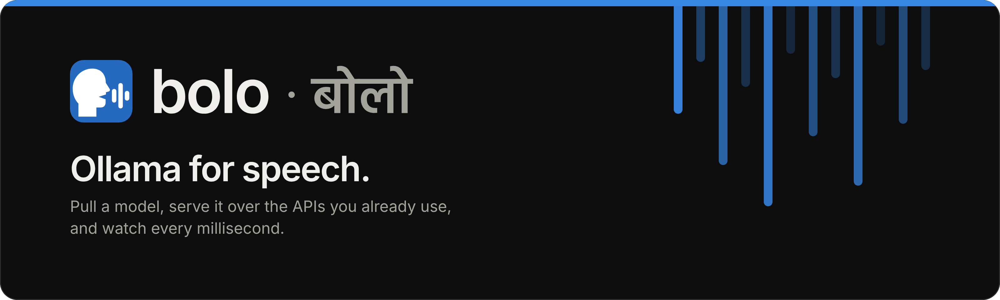
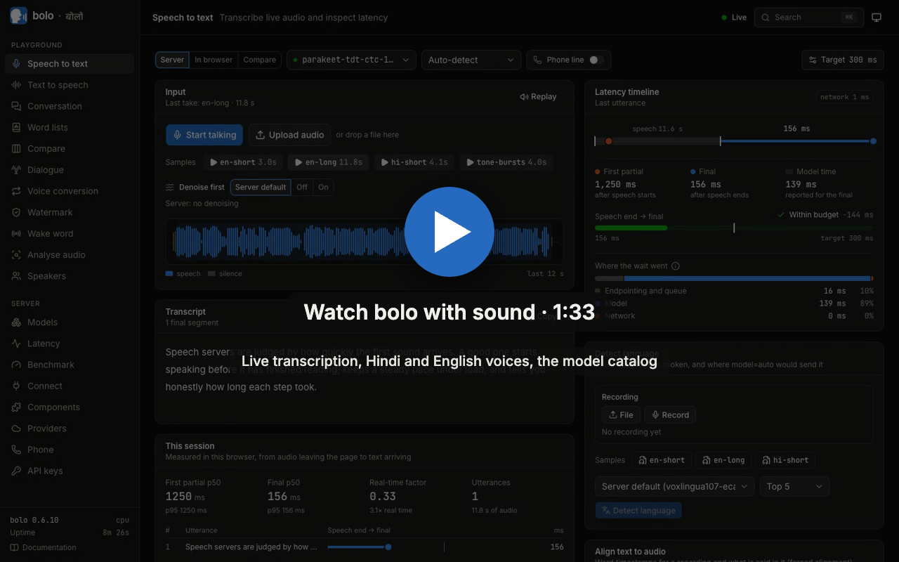
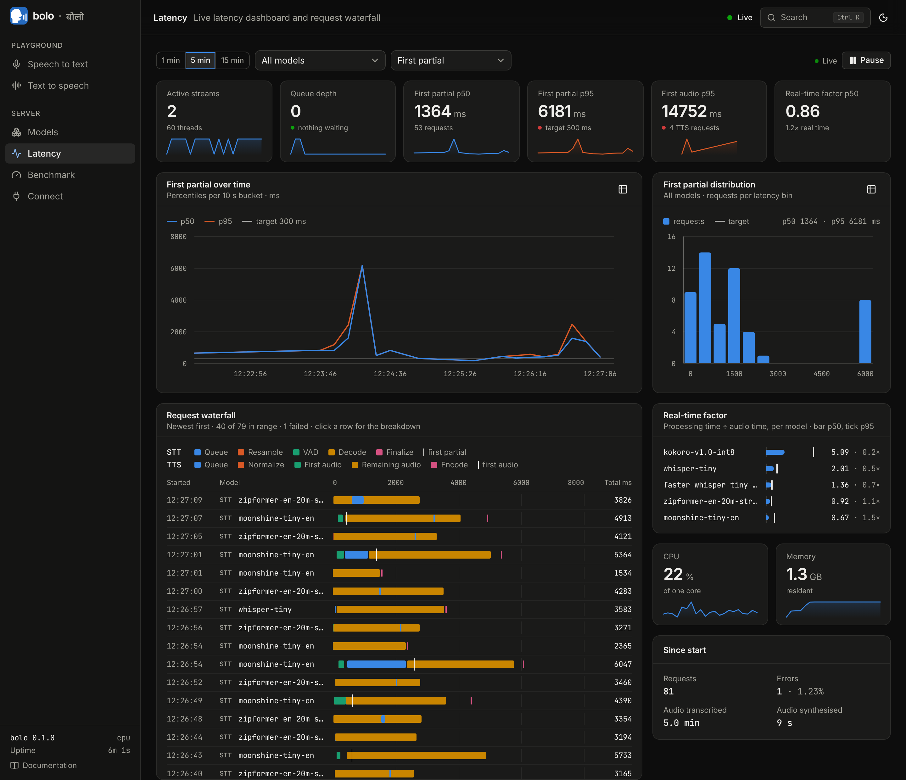
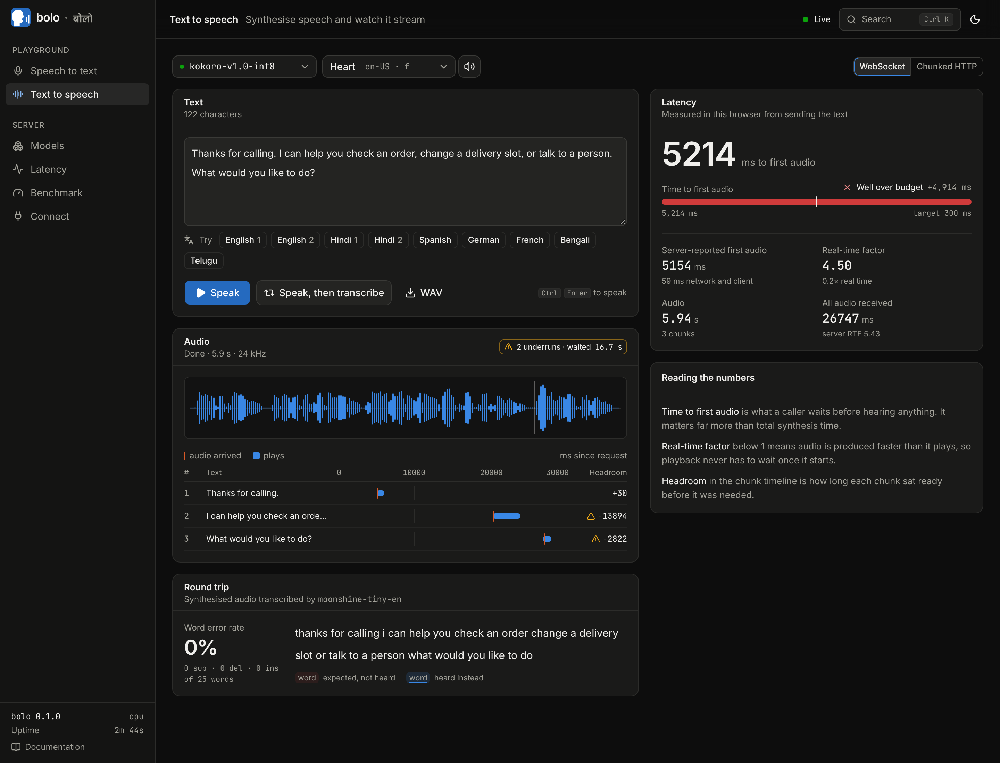
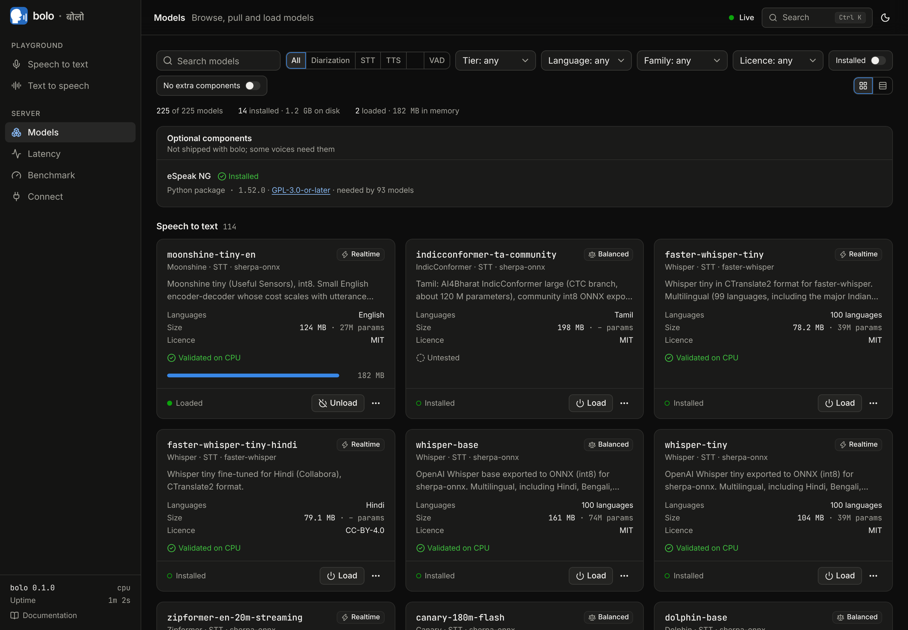
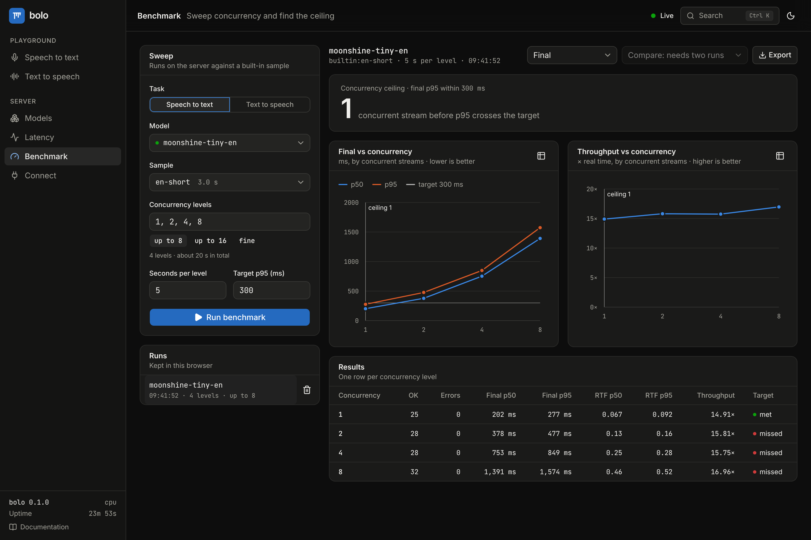

<p align="center">
  <a href="https://cb-sigma.github.io/bolo-speech/">
    <picture>
      <source media="(prefers-color-scheme: dark)" srcset="https://raw.githubusercontent.com/cB-Sigma/bolo-speech/main/docs/assets/brand/banner-dark.png">
      <source media="(prefers-color-scheme: light)" srcset="https://raw.githubusercontent.com/cB-Sigma/bolo-speech/main/docs/assets/brand/banner-light.png">
      
    </picture>
  </a>
</p>

<p align="center">
  <a href="https://github.com/cB-Sigma/bolo-speech/actions/workflows/ci.yml"></a>
  <a href="https://github.com/cB-Sigma/bolo-speech/blob/main/LICENSE"></a>
  <a href="https://pypi.org/project/bolo-speech/"></a>
  
</p>

<p align="center">
  <a href="https://cb-sigma.github.io/bolo-speech/"></a>
</p>

<table>
<tr>
<td width="58%" valign="top">

**bolo** is Ollama for speech: pull an open speech model by name and run it on your own machine, behind the
same API as OpenAI's.

- **Speech to text**: live or from files, with word timings and translation
- **Text to speech**: dozens of languages, streamed, with voice cloning
- **Diarization**: who spoke when, and speaker verification
- **Voice agents and phone calls**: Realtime API, WebRTC, SIP and phone providers
- **Audio tools**: noise removal, wake words, alignment, emotion, sound events, watermarks
- **Indian languages**: speech to text and voices for the major ones, with romanised input written in the right script
- **Cloud models alongside**: OpenAI, ElevenLabs, Deepgram, Sarvam and more, through the same API

Runs on NVIDIA, Apple silicon or a plain CPU. No PyTorch. Comes with a web console.

```bash
bolo pull whisper-large-v3-turbo
bolo transcribe meeting.wav --model whisper-large-v3-turbo
```

</td>
<td width="42%" valign="top">

**Install**

```bash
uv tool install "bolo-speech[all]"
bolo serve
```

then open <http://127.0.0.1:8000>.

Mac with Apple silicon, NVIDIA GPU, PyTorch models, Homebrew or Docker: see [Install](#install).

</td>
</tr>
</table>

## See it

<p align="center">
  <a href="https://github.com/cB-Sigma/bolo-speech/blob/main/docs/assets/bolo-tour.mp4"></a>
</p>
<p align="center">
  <sub>Recorded on a MacBook Pro (M4 Pro) on the Apple GPU. The narration is bolo's own voice (kokoro-v1.0-mlx).</sub>
</p>

## Quick start

Open <http://127.0.0.1:8000> for the console, or use the API. The first request for a model downloads it:

```bash
# speech to text (pulls whisper-base, about 160 MB, the first time)
curl http://127.0.0.1:8000/v1/audio/transcriptions -F file=@recording.wav -F model=whisper-1

# text to speech (pulls kokoro-v1.0-int8, about 170 MB, the first time)
curl http://127.0.0.1:8000/v1/audio/speech -H 'Content-Type: application/json' \
  -d '{"model": "tts-1", "voice": "af_heart", "input": "Hello from bolo."}' -o hello.mp3
```

With the official OpenAI SDK, only the base URL changes:

```python
from openai import OpenAI

client = OpenAI(base_url="http://127.0.0.1:8000/v1", api_key="not-needed")
text = client.audio.transcriptions.create(model="whisper-1", file=open("recording.wav", "rb")).text
client.audio.speech.create(model="tts-1", voice="alloy", input=text).write_to_file("echo.mp3")
```

Or choose models yourself:

```bash
bolo recommend                    # which models suit this machine (advice only: nothing is restricted)
bolo list --all -q english        # browse the catalog
bolo pull moonshine-tiny-en       # 124 MB, the fastest English recogniser here
bolo transcribe recording.wav -m moonshine-tiny-en
bolo speak "Hello there." -o hello.wav -m kokoro-v1.0-int8 --voice af_heart
bolo ps                           # what a running server has in memory: size, CPU/GPU, time until unload
bolo show kokoro-v1.0-int8        # licence, files, settings, voices, speed (`bolo list`, `rm`, `cp` as in Ollama)
bolo logs -f                      # the server's log file, when it writes one (log_file)
bolo doctor                       # engines, codecs, components, this machine, where the logs are
```

For a voice agent, point bolo at any OpenAI-compatible language model and connect a Realtime client to `ws://127.0.0.1:8000/v1/realtime` (or open the console's Conversation page):

```bash
bolo serve --llm-base-url http://127.0.0.1:11434/v1 --llm-model llama3.2      # Ollama, for example
```

More clients (curl, Python, Node, WebSockets, Pipecat, LiveKit Agents, Wyoming): [examples/](https://github.com/cB-Sigma/bolo-speech/tree/main/examples/).

## What it does

| | | More |
| --- | --- | --- |
| **OpenAI-compatible speech APIs** | `/v1/audio/transcriptions` (json, text, srt, vtt, verbose_json with word timestamps, SSE), translations, `/v1/audio/speech` (mp3, opus, aac, flac, wav, pcm, G.711; streamed as it is synthesised), `/v1/models`. OpenAI model and voice names map to your defaults. Also the model-management routes and environment variables of [speaches](https://github.com/speaches-ai/speaches), and streaming WebSockets for both directions | [api.md](https://github.com/cB-Sigma/bolo-speech/blob/main/docs/api.md), [migration-from-speaches.md](https://github.com/cB-Sigma/bolo-speech/blob/main/docs/migration-from-speaches.md) |
| **Realtime speech-to-text** | true streaming models, and stabilised partial results for models that were never designed to stream; endpointing you can tune | [realtime.md](https://github.com/cB-Sigma/bolo-speech/blob/main/docs/realtime.md) |
| **Voice agents, three pipelines** | the OpenAI Realtime API (`WS /v1/realtime`, WebRTC at `/v1/realtime/calls`) and audio in `/v1/chat/completions`, with turn detection, barge-in, function tools, tools from MCP servers (called by bolo, with approvals), server-side echo cancellation (SpeexDSP, WebRTC AEC3 or DTLN-aec) and per-turn traces. `cascade`: bolo's recogniser → your language model → bolo's voice. `audio-llm`: a model that hears the audio itself, bolo speaks. `speech-to-speech`: one model hears and speaks, behind a llama-server, a cloud Realtime API, or **in bolo's own process** (`lfm3-audio-2b-onnx`) | [voice-agents.md](https://github.com/cB-Sigma/bolo-speech/blob/main/docs/voice-agents.md) |
| **Pipelines** | chain any of bolo's models into one job, declared as JSON or YAML: denoise → diarize → transcribe → punctuate → redact → ask your language model, decide, branch, fan out per speaker, call a signed webhook, save files. Validated before they run, versioned, run at once or as a job with a signed callback (`POST /v1/pipelines/{id}/run`, `bolo pipeline run`), with templates for meeting notes, call QA, podcast chapters, dubbing and voicemail triage | [pipelines.md](https://github.com/cB-Sigma/bolo-speech/blob/main/docs/pipelines.md) |
| **Phone calls** | Twilio Media Streams, Plivo audio streams, Telnyx media streaming and the Exotel Voicebot applet connected to named agents; an experimental inbound SIP endpoint. Greeting, barge-in, key presses, hang-up and transfer, outbound calls with voicemail handling, signed webhooks, call records with a latency breakdown, a call simulator | [telephony.md](https://github.com/cB-Sigma/bolo-speech/blob/main/docs/telephony.md) |
| **Cloud providers next to local models** | OpenAI, Sarvam, ElevenLabs, Deepgram, Soniox or any OpenAI-compatible server behind the same routes, with bolo's diarization, word lists, telephony formats, traces and cost estimates on top, and **fallback** between local and cloud models in either direction. Audio leaves the server only when you name such a model | [providers.md](https://github.com/cB-Sigma/bolo-speech/blob/main/docs/providers.md) |
| **Who said what** | speaker diarization without PyTorch (pyannote segmentation with speaker embeddings, or NVIDIA's overlap-aware Nemotron), as `diarized_json`, in subtitles, on words and on live transcripts; known speakers named from reference recordings. **Speaker-attributed recognition**: DiCoW transcribes each speaker of a conversation separately, overlaps included, in the core (`dicow-v3.3-onnx`) or through the torch plugin | [models.md](https://github.com/cB-Sigma/bolo-speech/blob/main/docs/models.md#speaker-diarization-1) |
| **Voice cloning with a voice library** | save a person's voice once (cleaned, checked, **consent required** and recorded), then name it as the `voice` of any cloning model, OpenAI's custom-voice shape included; cloned speech is labelled; a speaker-similarity score, calibrated on real speech, says how alike the clone is; Tontaube, Chatterbox, Qwen3-TTS, Pocket TTS and more | [voices.md](https://github.com/cB-Sigma/bolo-speech/blob/main/docs/voices.md) |
| **A model catalog** | pull by name, with licences and gating on every entry and what was actually measured; `hf:owner/repo`, any Piper voice by name, local directories and URLs for everything else | [models.md](https://github.com/cB-Sigma/bolo-speech/blob/main/docs/models.md), [below](#models-and-licences) |
| **Hardware-aware recommendations** | bolo looks at the machine and rates every model for it; it recommends and warns, and never hides or refuses a model | [recommendations.md](https://github.com/cB-Sigma/bolo-speech/blob/main/docs/recommendations.md) |
| **Text preparation** | numbers, dates, money, units and URLs read out in the voice's language; pronunciation word lists for names and jargon; an SSML subset; romanised input ("mujhe kal jana hai") written in the voice's script; phonemes without the GPL through [uccharan](https://github.com/cb-Sigma/uccharan) | [api.md](https://github.com/cB-Sigma/bolo-speech/blob/main/docs/api.md#text-preparation-ssml-and-pronunciation-word-lists), [models.md](https://github.com/cB-Sigma/bolo-speech/blob/main/docs/models.md#phonemisers) |
| **Word timestamps for every recogniser** | words with start, end and confidence in `verbose_json` from every speech-to-text model: from the model where it gives them, else by aligning the transcript to the audio with a CTC forced aligner (Omnilingual ASR, Apache-2.0, 1,600+ languages as written; or the non-commercial MMS-300m aligner). `POST /v1/audio/alignments` aligns your own text to your audio, and **captioned speech** gives the time of every word the voice reads | [api.md](https://github.com/cB-Sigma/bolo-speech/blob/main/docs/api.md#word-timestamps-and-forced-alignment), [models.md](https://github.com/cB-Sigma/bolo-speech/blob/main/docs/models.md#word-timestamps) |
| **Hotwords, punctuation, numbers, redaction** | names and terms to favour (`hotwords`) on Whisper models and on the Zipformer and Parakeet transducers; punctuation and capital letters restored for recognisers that write none; numbers, money, dates and times written as figures (`itn`); personal information masked with an audit trail (`redact`); each per request or as the server's default | [api.md](https://github.com/cB-Sigma/bolo-speech/blob/main/docs/api.md#post-v1audiotranscriptions), [configuration.md](https://github.com/cB-Sigma/bolo-speech/blob/main/docs/configuration.md#redacting-personal-information) |
| **Language identification and routing** | `POST /v1/audio/language` says which language a recording is in, with probabilities, from a choice of identifiers (VoxLingua107 ECAPA, Whisper's own detector, AmberNet, MMS-LID), each with its licence; a transcription with `model=auto` is sent to the best installed recogniser for the language it hears, and the response header says what was decided. Never overrides a model or language you name | [api.md](https://github.com/cB-Sigma/bolo-speech/blob/main/docs/api.md#language-identification-and-routing), [models.md](https://github.com/cB-Sigma/bolo-speech/blob/main/docs/models.md#language-identification-1) |
| **Speaker verification and identification** | enrol people from a few recordings, then check whether a recording is a given person or which of them it is, with any of seven speaker embedders, each with a threshold measured on real speech | [api.md](https://github.com/cB-Sigma/bolo-speech/blob/main/docs/api.md#enrolled-speakers-verify-and-identify) |
| **Sound events and speech emotion** | `POST /v1/audio/tags` names the sounds in a recording (AudioSet's 527: speech, music and its instruments, laughter, alarms, animals, vehicles...) with CED and Zipformer taggers, over the whole recording or window by window; `POST /v1/audio/emotion` says how the speaker sounds (emotion2vec+, licence labelled); SenseVoice's own emotion and sound tags come back with its transcriptions; an audio language model answers questions about a recording, or captions it, through `/v1/chat/completions`. Background-noise removal on its own: `POST /v1/audio/denoise` | [api.md](https://github.com/cB-Sigma/bolo-speech/blob/main/docs/api.md#sound-events-and-audio-tags-post-v1audiotags), [models.md](https://github.com/cB-Sigma/bolo-speech/blob/main/docs/models.md#audio-tagging-and-sound-events) |
| **Classify audio your way** | `POST /v1/audio/classify` scores a clip against labels you write in plain words ("hold music", "an angry voice", "a dog barking") with CLAP models (LAION, Microsoft) on ONNX Runtime, whole or window by window; or train a classifier from a few dozen clips per class (`POST /v1/audio/classifiers`, `bolo classifier train`), kept as a local model with its cross-validated accuracy | [api.md](https://github.com/cB-Sigma/bolo-speech/blob/main/docs/api.md#classify-against-your-own-labels-post-v1audioclassify) |
| **Indian languages** | recognition and voices for the major Indian languages, Bhojpuri, Magahi and Chhattisgarhi among them, 8 kHz G.711 in and out | [indic-telephony.md](https://github.com/cB-Sigma/bolo-speech/blob/main/docs/indic-telephony.md) |
| **A web console** | playgrounds, the catalog, latency dashboards, benchmarks, conversations, calls, served by the same process | [below](#the-console) |
| **Engine plugins** | models that need another runtime run out of process behind the same API: [bolo-torch](https://github.com/cB-Sigma/bolo-speech/blob/main/plugins/bolo-torch/README.md) for PyTorch models | [plugins.md](https://github.com/cB-Sigma/bolo-speech/blob/main/docs/plugins.md) |
| **Wake words** | keyword spotting for any phrase you type (sherpa-onnx), openWakeWord and microWakeWord models, on a recording or a live stream, over Wyoming and from the console | [api.md](https://github.com/cB-Sigma/bolo-speech/blob/main/docs/api.md#wake-words-post-apiv1wake-ws-apiv1wakestream) |
| **Wyoming** | speech-to-text, text-to-speech and wake words for Home Assistant on one TCP port | [api.md](https://github.com/cB-Sigma/bolo-speech/blob/main/docs/api.md#wyoming-protocol), [examples/home_assistant.md](https://github.com/cB-Sigma/bolo-speech/blob/main/examples/home_assistant.md) |
| **Ollama-style model scheduling** | each model goes on the GPU when it fits in free VRAM and on the CPU when it does not (llama.cpp models split by layers, ONNX models by graph or cut in two at a layer boundary); several GPUs (`gpus`, `gpu_spread`, `--tensor-split` for llama.cpp); `keep_alive` per request, `num_parallel` and `max_queue` per model, flash attention and a quantized KV cache for llama.cpp voices; `bolo ps` with size, CPU/GPU split, GPU and time until unload, `bolo load` / `stop` / `show` / `rm` / `cp` (presets) / `logs`, a "Loaded models" panel in the console; `OLLAMA_*` variables mapped. GPU side tested with fakes, and with whole models on one laptop's GPU | [configuration.md](https://github.com/cB-Sigma/bolo-speech/blob/main/docs/configuration.md#gpu-and-cpu-placement), [coming from Ollama](https://github.com/cB-Sigma/bolo-speech/blob/main/docs/configuration.md#coming-from-ollama), [api.md](https://github.com/cB-Sigma/bolo-speech/blob/main/docs/api.md#keep-alive) |
| **API keys per client** | keys with scopes (`stt`, `tts`, `realtime`, `manage`, `admin`), a requests-per-minute rate limit, a daily, monthly or total quota and usage counters, from `bolo keys`, `/api/v1/keys` or the console; only a hash of each key is stored | [api.md](https://github.com/cB-Sigma/bolo-speech/blob/main/docs/api.md#api-keys-apiv1keys) |
| **Server behaviour** | per-model queues with micro-batching, backpressure (`429`, not a growing delay), cancellation, lazy loading, idle unloading, a memory budget, resumable verified downloads, Prometheus metrics, and a phase-by-phase trace of every request, exportable to OpenTelemetry | [architecture.md](https://github.com/cB-Sigma/bolo-speech/blob/main/docs/architecture.md), [configuration.md](https://github.com/cB-Sigma/bolo-speech/blob/main/docs/configuration.md#opentelemetry) |

## Models and licences

<!-- BEGIN GENERATED: models-summary -->
| Task | Family | Models | Languages | Validated on CPU | Best measured RTF |
| --- | --- | --- | --- | --- | --- |
| ALIGN | Omnilingual ASR | 1 | ar, as, bn, de, en, es, fr, gu +23 | 1 | 0.888 (`omnilingual-ctc-300m-align`) |
| ALIGN | MMS | 1 | - | 1 | 1.137 (`mms-300m-forced-aligner`) |
| AUDIO-CLASSIFY | LAION CLAP | 3 | en | 3 | 0.262 (`clap-htsat-unfused`) |
| AUDIO-CLASSIFY | MS-CLAP | 1 | en | 1 | 0.295 (`msclap-2023`) |
| AUDIO-LLM | LFM2.5-Audio 1.5B | 1 | en | 0 | - |
| AUDIO-LLM | Ultravox 0.5 | 1 | ar, de, en, es, fr, hi, it, ja +7 | 0 | - |
| AUDIO-LLM | Qwen2.5-Omni 3B | 1 | en, zh | 0 | - |
| AUDIO-LLM | Qwen2.5-Omni 7B | 1 | en, zh | 0 | - |
| AUDIO-LLM | Qwen3-Omni 30B-A3B | 1 | ar, de, en, es, fr, id, it, ja +10 | 0 | - |
| AUDIO-LLM | Gemma 4 E2B | 1 | en | 0 | - |
| AUDIO-LLM | Gemma 4 E4B | 1 | en | 0 | - |
| AUDIO-TAGGING | CED | 4 | - | 4 | 0.034 (`ced-tiny`) |
| AUDIO-TAGGING | Zipformer | 2 | - | 2 | 0.126 (`zipformer-small-audio-tagging`) |
| STT | OpenAI (cloud) | 4 | af, am, ar, as, az, ba, be, bg +92 | 0 | - |
| TTS | OpenAI (cloud) | 3 | af, am, ar, as, az, ba, be, bg +92 | 0 | - |
| STT | Sarvam (cloud) | 3 | as, bn, brx, doi, en, gu, hi, kn +15 | 0 | - |
| TTS | Sarvam (cloud) | 3 | bn, en, gu, hi, kn, ml, mr, or +3 | 0 | - |
| TTS | ElevenLabs (cloud) | 3 | ar, bg, cs, da, de, el, en, es +24 | 0 | - |
| DENOISE | ElevenLabs (cloud) | 1 | - | 0 | - |
| STT | ElevenLabs (cloud) | 3 | af, am, ar, as, ast, az, ba, be +111 | 0 | - |
| STT | Deepgram (cloud) | 2 | af, ar, as, be, bg, bn, bs, ca +53 | 0 | - |
| STT | Soniox (cloud) | 2 | af, ar, az, be, bg, bn, bs, ca +52 | 0 | - |
| STT | AssemblyAI (cloud) | 3 | af, ar, ca, da, de, en, es, et +24 | 0 | - |
| SPEECH-TO-SPEECH | xAI (cloud) | 1 | ar, bn, de, en, es, fr, hi, id +8 | 0 | - |
| SPEECH-TO-SPEECH | Rime (cloud) | 1 | en | 0 | - |
| STT | Microsoft MAI (cloud) | 1 | af, ar, as, az, bg, bn, bs, ca +52 | 0 | - |
| TTS | Microsoft MAI (cloud) | 2 | cs, da, de, en, es, fi, fr, hi +15 | 0 | - |
| SPEECH-TO-SPEECH | Amazon Nova (cloud) | 1 | de, en, es, fr, hi, it, pt | 0 | - |
| DECISION | Gemini Decision (cloud) | 1 | en | 0 | - |
| DECISION | d1-omni | 1 | en | 0 | - |
| DECISION | Clef-Omni | 1 | en | 0 | - |
| DENOISE | GTCRN | 1 | - | 1 | 0.060 (`gtcrn-simple`) |
| DENOISE | DPDFNet | 8 | - | 8 | 0.080 (`dpdfnet-baseline`) |
| DENOISE | DeepFilterNet | 1 | - | 1 | 0.259 (`deepfilternet3`) |
| DENOISE | RNNoise | 1 | - | 1 | 0.068 (`rnnoise`) |
| DENOISE | Demucs denoiser | 4 | - | 4 | 0.194 (`demucs-dns48`) |
| DIARIZATION | pyannote + speaker embeddings | 4 | - | 2 | 0.106 (`pyannote-3.0-eres2net`) |
| DIARIZATION | Nemotron diarization | 1 | - | 1 | 0.039 (`nemotron-3-diarization`) |
| SPEECH-TO-SPEECH | Moshi | 14 | en | 0 | - |
| SPEECH-TO-SPEECH | Hibiki | 4 | en, fr | 0 | - |
| SPEECH-TO-SPEECH | Hibiki-Zero | 1 | de, en, es, fr, pt | 0 | - |
| SPEECH-TO-SPEECH | PersonaPlex | 2 | en | 0 | - |
| SPEECH-TO-SPEECH | FLM-Audio | 1 | en, zh | 0 | - |
| SPEECH-TO-SPEECH | Freeze-Omni | 1 | en, zh | 0 | - |
| SPEECH-TO-SPEECH | MiniCPM-o 4.5 | 1 | en, zh | 0 | - |
| ECHO-CANCELLATION | SpeexDSP | 1 | - | 1 | 0.026 (`speex-aec`) |
| ECHO-CANCELLATION | WebRTC AEC3 | 1 | - | 1 | 0.026 (`webrtc-aec3`) |
| ECHO-CANCELLATION | DTLN-aec | 1 | - | 1 | 0.233 (`dtln-aec-128`) |
| EMOTION | emotion2vec+ | 2 | - | 2 | 0.845 (`emotion2vec-plus-large`) |
| ITN | WeTextProcessing | 3 | en, hi, zh | 3 | 0.001 (`itn-zh-wetext`) |
| ITN | sherpa-onnx rule FSTs | 1 | zh | 1 | 0.000 (`itn-zh-number`) |
| LID | VoxLingua107 ECAPA-TDNN | 2 | ab, af, am, ar, as, az, ba, be +99 | 2 | 0.106 (`voxlingua107-ecapa`) |
| LID | Whisper | 2 | af, am, ar, as, az, ba, be, bg +91 | 2 | 0.301 (`whisper-tiny-lid`) |
| LID | AmberNet | 1 | ab, af, am, ar, as, az, ba, be +99 | 1 | 0.104 (`ambernet-langid`) |
| LID | MMS-LID | 2 | aaa, aab, aac, aad, aaf, aai, aal, aar +4008 | 0 | - |
| LID | Voxlect | 2 | as, bn, brx, doi, en, gu, hi, kn +15 | 1 | 0.558 (`voxlect-indic-lid-whisper-small`) |
| LID | SpeechBrain ECAPA-TDNN | 1 | en, hi, mr, ta, te | 1 | 0.130 (`lid-indic-vaani`) |
| LID | mHuBERT-147 SLID | 2 | as, bn, brx, doi, gu, hi, kn, kok +14 | 2 | 0.226 (`indic-slid-mhubert-task2`) |
| STT | Whisper | 69 | af, am, ar, as, az, ba, be, bg +92 | 22 | 0.081 (`faster-whisper-tiny.en`) |
| STT | Parakeet | 8 | bg, cs, da, de, el, en, es, et +17 | 5 | 0.030 (`parakeet-tdt-ctc-110m`) |
| TTS | Kokoro | 3 | en, es, fr, hi, it, ja, pt, zh | 3 | 0.759 (`kokoro-v1.0`) |
| STT | SOV-Transcribe | 3 | de, en, es, fr, it, nl, pt | 0 | - |
| PII | Presidio | 2 | en | 2 | 0.001 (`pii-presidio-patterns`) |
| PII | GLiNER | 1 | de, en, es, fr, it, nl, pt | 1 | 0.100 (`pii-gliner-multi`) |
| TTS | Parler-TTS | 2 | as, bn, brx, doi, en, gu, hi, hne +13 | 2 | 4.540 (`parler-tts-tiny-v1`) |
| TTS | F5-TTS | 2 | as, bn, en, gu, hi, kn, ml, mr +5 | 1 | 119.700 (`indic-f5`) |
| TTS | Veena | 1 | en, hi | 0 | - |
| TTS | Svara | 1 | as, bho, bn, brx, doi, en, gu, hi +11 | 0 | - |
| STT | SraVaani | 1 | as, bn, en, gu, hi, kn, ml, mr +6 | 0 | - |
| STT | IndicConformer | 27 | as, bn, brx, doi, gu, hi, kn, kok +14 | 20 | 0.060 (`indicconformer-ta-community`) |
| SEPARATION | SepFormer | 6 | en | 6 | 1.440 (`sepformer-whamr`) |
| SEPARATION | PixIT | 1 | en | 1 | 5.690 (`pixit-ami`) |
| DIARIZATION | pyannote (PyTorch) | 3 | - | 3 | 0.876 (`pyannote-speaker-diarization-community-1`) |
| STT | Reverb | 1 | en | 1 | 0.050 (`reverb-asr`) |
| STT | DiCoW | 3 | en | 3 | 0.453 (`dicow-v3.3`) |
| STT | Jais-ASR | 1 | ar, en, es, fr, it | 0 | - |
| TTS | Indic-Speak | 1 | as, bn, brx, doi, en, gu, hi, kn +15 | 0 | - |
| TTS | Spark-TTS | 1 | en, zh | 0 | - |
| TTS | MaskGCT | 1 | de, en, fr, ja, ko, zh | 0 | - |
| DIARIZATION | DiariZen | 1 | - | 1 | 12.400 (`diarizen-wavlm-large-s80-md-v2`) |
| SPEECH-TO-SPEECH | Qwen2.5-Omni 3B | 1 | en, zh | 0 | - |
| SPEECH-TO-SPEECH | Qwen2.5-Omni 7B | 1 | en, zh | 0 | - |
| SPEECH-TO-SPEECH | Qwen3-Omni 30B-A3B | 1 | de, en, es, fr, it, ja, ko, pt +2 | 0 | - |
| SPEECH-TO-SPEECH | GLM-4-Voice | 1 | en, zh | 0 | - |
| SPEECH-TO-SPEECH | MiniCPM-o 2.6 | 1 | en, zh | 0 | - |
| SPEECH-TO-SPEECH | Step-Audio 2 | 1 | en, zh | 0 | - |
| SPEECH-TO-SPEECH | Kimi-Audio | 1 | en, zh | 0 | - |
| PUNCTUATION | Edge-Punct-Casing | 1 | en | 1 | 0.001 (`punct-en-cnn-bilstm`) |
| PUNCTUATION | CT-Transformer | 1 | en, zh | 1 | 0.002 (`punct-zh-en-ct-transformer`) |
| TTS | LFM3-Audio 2B | 1 | ar, da, de, el, en, es, fi, fr +10 | 0 | - |
| SEPARATION | VoxLock | 1 | en | 1 | 0.460 (`voxlock-int8`) |
| SPEAKER-EMBEDDING | ERes2Net | 1 | - | 1 | 0.259 (`eres2net-voxceleb`) |
| SPEAKER-EMBEDDING | CAM++ | 3 | - | 3 | 0.116 (`wespeaker-campplus-voxceleb`) |
| SPEAKER-EMBEDDING | WeSpeaker ResNet | 1 | - | 1 | 0.126 (`wespeaker-resnet34-voxceleb`) |
| SPEAKER-EMBEDDING | TitaNet | 1 | - | 1 | 0.068 (`titanet-small`) |
| SPEAKER-EMBEDDING | ECAPA-TDNN | 1 | - | 1 | 0.203 (`ecapa-tdnn-voxceleb`) |
| STT | Whistle | 1 | de, en, es, fr, it, nl, pl | 1 | 0.244 (`whistle`) |
| STT | Voxtral | 2 | de, en, es, fr, hi, it, nl, pt | 1 | 1.980 (`voxtral-mini-3b-llamacpp`) |
| STT | Nemotron 3.5 Transcribe | 2 | ar, bg, bn, cs, da, de, el, en +32 | 0 | - |
| STT | Canary-Qwen | 1 | en | 1 | 3.194 (`canary-qwen-2.5b-onnx`) |
| STT | Moonshine | 11 | ar, en, es, ja, ko, uk, vi, zh | 4 | 0.033 (`moonshine-tiny-en`) |
| STT | NeMo FastConformer | 8 | be, de, en, es, fr, hr, it, pl +2 | 3 | 0.334 (`nemo-fastconformer-ctc-en-streaming-480ms`) |
| STT | Canary | 2 | bg, cs, da, de, el, en, es, et +17 | 2 | 0.358 (`canary-180m-flash`) |
| STT | Zipformer | 16 | ar, bn, de, en, es, fr, id, ja +5 | 7 | 0.028 (`zipformer-en-gigaspeech`) |
| STT | SenseVoice | 1 | en, ja, ko, yue, zh | 1 | 0.039 (`sense-voice-small`) |
| STT | Paraformer | 2 | en, zh | 1 | 0.091 (`paraformer-zh`) |
| STT | Dolphin | 2 | ar, bn, fa, gu, hi, id, ja, jv +26 | 1 | 0.021 (`dolphin-base`) |
| STT | Omnilingual ASR | 1 | ar, as, bn, de, en, es, fr, gu +23 | 1 | 0.112 (`omnilingual-ctc-300m`) |
| STT | Nemotron | 1 | ar, bg, cs, da, de, el, en, es +26 | 1 | 0.312 (`nemotron-3.5-streaming-560ms`) |
| STT | Rumble | 1 | af, ar, bn, bs, ca, ceb, cs, da +37 | 1 | 0.463 (`rumble-2-flash`) |
| STT | Qwen3-ASR | 2 | ar, cs, da, de, el, en, es, fa +22 | 2 | 0.723 (`qwen3-asr-0.6b`) |
| STT | Cohere Transcribe | 1 | ar, de, el, en, es, fr, it, ja +6 | 1 | 0.859 (`cohere-transcribe-03-2026`) |
| TTS | MMS-TTS | 25 | as, awa, bgc, bn, de, doi, en, es +17 | 1 | 0.196 (`mms-tts-eng`) |
| TTS | Orpheus family on llama.cpp (SNAC in onnxruntime) | 6 | as, bho, bn, brx, doi, en, gu, hi +11 | 0 | - |
| TTS | Piper | 85 | ar, bn, ca, cs, cy, da, de, el +35 | 28 | 0.040 (`piper-ne-np-google-medium`) |
| TTS | External TTS server: llama-server | 17 | ar, da, de, el, en, es, fi, fr +20 | 10 | 0.397 (`pocket-tts-it-llamacpp`) |
| TTS | External TTS server: audio.cpp | 49 | ar, be, bg, bn, cs, da, de, el +41 | 10 | 0.674 (`gradium-phonon-40m-de-audiocpp`) |
| TTS | External TTS server: tontaube | 2 | de, en, es, fr, it, nl, pt | 0 | - |
| TTS | KittenTTS | 4 | en | 4 | 0.107 (`kitten-nano-0.8`) |
| TTS | Matcha-TTS | 2 | en, zh | 1 | 0.205 (`matcha-en-ljspeech`) |
| TTS | MeloTTS | 1 | en | 1 | 0.278 (`melo-tts-en`) |
| TTS | VITS | 26 | bho, bn, en, gu, hi, hne, kn, mag +4 | 4 | 0.046 (`mimic3-gu-cmu-indic`) |
| TTS | tiny-voca | 1 | en | 0 | - |
| TTS | little-tts | 1 | en | 1 | 0.025 (`little-tts-onnx`) |
| TTS | Paradee | 1 | en | 1 | 0.084 (`paradee-8m-onnx`) |
| TTS | PiVo | 1 | en | 1 | 0.659 (`pivo-1.4m-onnx`) |
| TTS | kale-tts-1 | 1 | en | 1 | 0.028 (`kale-tts-1-nano-onnx`) |
| TTS | Kitten TTS 2 Pico | 1 | de, en, es, fr, hi, it, pt, ru | 1 | 0.124 (`kitten-tts-2-pico-onnx`) |
| TTS | Kitten TTS 2 Mini | 1 | da, de, en, es, fi, fr, hi, it +7 | 1 | 0.608 (`kitten-tts-2-mini-onnx`) |
| TURN | Smart Turn | 5 | ar, bn, da, de, en, es, fi, fr +15 | 5 | 0.043 (`smart-turn-v3.0`) |
| TURN | Namo Turn Detector | 2 | ar, bn, da, de, en, es, fi, fr +15 | 2 | 0.011 (`namo-turn-en`) |
| TURN | Silence only | 1 | - | 1 | 0.000 (`silence-only`) |
| TURN | TEN Turn Detection | 1 | en, zh | 0 | - |
| VAD | Silero VAD | 3 | - | 3 | 0.006 (`silero-vad-v5`) |
| VAD | TEN VAD | 2 | - | 2 | 0.009 (`ten-vad`) |
| VAD | MarbleNet VAD | 1 | - | 1 | 0.069 (`marblenet-vad`) |
| VAD | WebRTC VAD | 2 | - | 2 | 0.000 (`webrtc-vad-aggressive`) |
| VAD | Energy VAD | 1 | - | 1 | 0.000 (`energy-vad`) |
| VOICE-CONVERSION | OpenVoice v2 tone colour converter | 1 | - | 1 | 2.930 (`openvoice-v2-tone-color-audiocpp`) |
| VOICE-CONVERSION | MeanVC2 | 1 | - | 1 | 3.750 (`meanvc2-audiocpp`) |
| VOICE-CONVERSION | Chatterbox VC | 1 | - | 0 | - |
| VOICE-CONVERSION | RVC | 1 | - | 1 | 6.190 (`rvc-audiocpp`) |
| VOICE-CONVERSION | Seed-VC | 1 | - | 0 | - |
| WAKE-WORD | Zipformer keyword spotter | 2 | en, zh | 2 | 0.083 (`kws-zipformer-zh-en`) |
| WAKE-WORD | openWakeWord | 3 | en | 3 | 0.082 (`openwakeword-hey-mycroft`) |
| WAKE-WORD | microWakeWord | 4 | en | 4 | 0.003 (`microwakeword-hey-jarvis`) |
| WATERMARK | AudioSeal | 1 | - | 0 | - |
| WATERMARK | Perth | 1 | - | 1 | 0.033 (`perth-onnx`) |
| WATERMARK | WavMark | 1 | - | 1 | 2.300 (`wavmark-onnx`) |

**556 models in the catalog, 253 validated on CPU, 303 untested**, plus 34 cloud models (paid cloud APIs; audio leaves this server; [docs/providers.md](https://github.com/cB-Sigma/bolo-speech/blob/main/docs/providers.md)). Full list: [docs/models.md](https://github.com/cB-Sigma/bolo-speech/blob/main/docs/models.md).
<!-- END GENERATED: models-summary -->

"Validated on CPU" means downloaded and run by `server/tools/validate_models.py` on the machine described under [Performance](#performance); everything else says *untested*. The full table, with each model's licence and measured real-time factor, is [docs/models.md](https://github.com/cB-Sigma/bolo-speech/blob/main/docs/models.md). Anything else that sherpa-onnx or faster-whisper can load is added with `bolo pull hf:<owner>/<repo>`.

**Licences are labelled, not filtered.** Every entry states `license`, `commercial_use` and `gated`, the console shows them, and you decide what to download. Non-commercial models (MMS-TTS, some Piper voices, non-English Moonshine, several LLM-based voices) and models with conditional terms are in the catalog and marked ⚠. The default models are permissively licensed; the one exception is the opt-in speech-to-speech pipeline, whose default model (LFM3-Audio, LFM Open License) allows commercial use only below a revenue threshold. Gated models are fetched only with your own Hugging Face token. Cloud models are labelled as paid APIs that receive your audio. How each restricted model runs: [docs/models.md](https://github.com/cB-Sigma/bolo-speech/blob/main/docs/models.md#non-commercial-and-restricted-models-and-how-each-runs).

**No PyTorch in the server.** Inference runs on ONNX Runtime (through [sherpa-onnx](https://github.com/k2-fsa/sherpa-onnx) and directly) and CTranslate2 (through [faster-whisper](https://github.com/SYSTRAN/faster-whisper)); LLM-based voices run on llama.cpp's `llama-server` or audio.cpp, which bolo can install and start. Models that need PyTorch run in the separate [bolo-torch](https://github.com/cB-Sigma/bolo-speech/blob/main/plugins/bolo-torch/README.md) process. bolo runs no text language model itself: voice agents use the one you connect.

## Models for your machine

```bash
bolo recommend                              # this machine, and a default pick per task
bolo recommend --task stt --language hi     # every Hindi recogniser, best fit first
bolo recommend --use live --language en     # a whole setup: speech-to-text + text-to-speech
bolo recommend --benchmark                  # measure this machine first (about three seconds)
bolo check step-audio-2-mini --tiny         # would it run? checked without downloading its weights
```

bolo detects the CPU and its instruction sets, memory, GPUs, the runtimes that can use them and container limits, and rates every model `comfortable`, `usable`, `slow` or `unlikely to fit`, with the expected real-time factor and the reason. The same is on the console's Models page ("This machine", a fit line per model, "Pick for me") and in `bolo list`.

**It recommends; it never restricts.** No model is hidden, refused or blocked because of hardware; pulling or loading one that is unlikely to fit only adds a notice. The one exception: a full-duplex model (Moshi, Hibiki, PersonaPlex, ...) that needs more GPU memory than the GPU has is not started, since it cannot be split across the GPU and the CPU.

**Check before you download.** `bolo check <model>` (the console's "Check" button, `POST /api/v1/models/{id}/check`) finds out whether a model would run without downloading its weights: its runtime (engine, component or plugin environment, and its imports), every weight file at its pinned revision (there or gated, the right size) and where the advisor would put it on this machine. `--tiny` also builds a transformers-based bolo-torch model from its configuration with tiny dimensions and random weights and loads and runs it the way bolo would (GPU/CPU split planning, bfloat16), so a model meant for a bigger machine is checked on a small one. What cannot be built small is reported as skipped, never as passed. [docs/recommendations.md](https://github.com/cB-Sigma/bolo-speech/blob/main/docs/recommendations.md#checking-a-model-before-downloading-it).

The estimates are rough and say so: the catalog's real-time factors were measured on one reference machine and are scaled to yours by a three-second benchmark, or by a rule of thumb when it has not run; about two thirds of the catalog was never run by the maintainers and is estimated from a similar model or marked as a guess; **nothing was measured on a GPU**. [docs/recommendations.md](https://github.com/cB-Sigma/bolo-speech/blob/main/docs/recommendations.md).

## Voice agents and phone calls

bolo is the speech side of a voice agent: you bring a language model (Ollama, llama.cpp, vLLM, a hosted API), bolo hears, detects the end of the turn, speaks the answer as the tokens arrive and stops when the caller interrupts. Clients connect with the OpenAI Realtime API over WebSocket or WebRTC, with audio in chat completions, or by phone. It was run from the official OpenAI SDK, Pipecat and LiveKit Agents.

On a phone line the same session answers calls from Twilio, Plivo, Telnyx or Exotel, or from a SIP trunk (experimental: G.711 over UDP, no registration, authentication or encryption). `bolo telephony simulate` rings an agent through a fake provider and reports what the caller heard and how long each turn took, without a phone account.

Two things to know before relying on it: the quality of a conversation is the quality of the language model you connect (bolo was developed with models of 360M and 500M parameters, enough to prove the path and no more), and **no real phone call has been made with this code**. [docs/voice-agents.md](https://github.com/cB-Sigma/bolo-speech/blob/main/docs/voice-agents.md), [docs/telephony.md](https://github.com/cB-Sigma/bolo-speech/blob/main/docs/telephony.md).

## Text, pronunciation and romanised input

Voices differ in what they read: phonemes, plain text or a fixed character set. bolo keeps a record per voice and prepares text accordingly:

- **Normalisation.** Numbers, money with lakh and crore, dates, times, phone numbers, units, abbreviations, URLs and email addresses are written out in words in the voice's language: by uccharan's phonemiser for voices that read phonemes (all its languages), and by its normalise-only mode for voices that read text (all its languages since uccharan 0.6.2; bolo's own small normaliser for other languages, and without uccharan).
- **Pronunciation word lists.** Named lists (TSV, PLS or JSON) say how names, brands and jargon are spoken; each voice gets the entry as phonemes, markup or a respelling, whichever it can take. Per request, pinned per model, or for everything.
- **SSML.** A subset: `<sub>`, `<phoneme>`, `<say-as>`, `<break>`, `<p>`, `<s>`, `<lang>`. Kokoro-style `[word](/ipa/)` works in every format.
- **Romanised input.** With `"romanised": "auto"`, Hindi typed in Latin letters is written in Devanagari before a Hindi voice reads it, and English words are left alone. This needs uccharan and the language's pack (CC BY-SA 4.0, installed on request); without them the text is spoken as written and the request's trace says what is missing. Off by default.
- **Phonemes without the GPL.** Piper-format voices, KittenTTS, Matcha and Kokoro read phonemes. uccharan (Apache-2.0) provides them in its 39 languages: English (US, British), Hindi, Bengali, Marathi, Telugu, Nepali, Kannada, Tamil, Malayalam, Assamese, Gujarati, Bhojpuri, Maithili, Magahi, Punjabi, Odia, Konkani, Sinhala, Sanskrit, Urdu, Sindhi, Spanish, German, Dutch, French (also Belgian and Swiss), Italian, Portuguese (Brazil, Portugal), Polish, Turkish, Czech, Swedish, Catalan, Romanian, Hungarian, Finnish, Norwegian Bokmål and Danish. Voices in those languages work as installed (69 catalog voices, and Kokoro's English, Spanish, French, Italian, Portuguese and Hindi voices); a language's word table is downloaded from uccharan's release the first time a voice needs it (`uccharan_auto_download`, or `bolo pull uccharan-de` ahead of time). Voices in other languages (Russian, Mandarin, Arabic, Persian, Latin American Spanish …) need eSpeak NG, which is optional and never installed unless you ask.

[docs/api.md](https://github.com/cB-Sigma/bolo-speech/blob/main/docs/api.md#text-preparation-ssml-and-pronunciation-word-lists), [docs/models.md](https://github.com/cB-Sigma/bolo-speech/blob/main/docs/models.md#phonemisers).

## Indian languages

- **Recognition for all 22 scheduled languages**, one IndicConformer model per language (AI4Bharat, MIT; ungated community ONNX exports pinned to a commit). Sixteen were run here on real recordings (10 to 60 utterances each): character error rates from 2.5 % (Bengali) to 14.9 % (Assamese). Bodo, Dogri, Kashmiri, Konkani, Manipuri and Santali are untested for lack of public test recordings.
- **Voices** for Hindi, Bengali, Telugu, Tamil, Malayalam, Marathi, Urdu, Nepali, Gujarati, Kannada, Maithili, Bhojpuri, Magahi and Chhattisgarhi under permissive licences, and non-commercial MMS voices for Punjabi, Odia, Assamese, Dogri and more. No voice that runs without PyTorch for Sanskrit, Sindhi, Kashmiri, Konkani, Manipuri, Bodo or Santali.
- **Which language is it?** `POST /v1/audio/language` identifies the spoken language, and `model=auto` sends a transcription to the best installed recogniser for it (an IndicConformer model for its language, when one is installed). The default identifier, VoxLingua107 ECAPA (Apache-2.0), named the right language for 33 of 39 synthesised clips in 13 Indian languages; it does not know Odia, and it heard Urdu as Hindi ([models.md](https://github.com/cB-Sigma/bolo-speech/blob/main/docs/models.md#language-identification-1)).
- **Bhojpuri** has no recogniser of its own that beats the Hindi model: 41 % word error rate on 120 utterances with the Hindi model, 48 % with the Bhojpuri Whisper fine-tune we converted.
- Hindi numbers in the Indian system (`250000` → दो लाख पचास हज़ार), sentences split at the danda, Hinglish in Latin script, and 8 kHz G.711 μ-law and A-law in both directions.

These are small samples that show the pipelines work, not accuracy benchmarks, and nobody who speaks the languages reviewed the synthesised audio. The table per language, with licences: [docs/indic-telephony.md](https://github.com/cB-Sigma/bolo-speech/blob/main/docs/indic-telephony.md).

## The console

Served at `/` by the same process, and as a browser-only [live demo](https://cb-sigma.github.io/bolo-speech/).

| Page | What it is for |
| --- | --- |
| Speech to text | talk, upload or play a sample; partial and final text, speaker labels, and a timeline of where the wait after you stopped speaking went; the same audio through the server and through a model in the page |
| Text to speech | streamed playback, time to first audio, per-chunk timeline, voice cloning, SSML, word lists, romanised text, and a round trip back through recognition |
| Models | search and filter the catalog, pull with progress, load and unload, per-model settings, fit for this machine and "Pick for me" |
| Latency | live percentiles against your target and a waterfall of every request with its phases |
| Benchmark | sweep concurrency and find the ceiling for a latency target |
| Conversation | talk to a voice agent and choose its pipeline |
| Phone | telephony providers and the addresses to paste into their dashboards, agents, numbers, recent calls with per-turn latency, and "Simulate a call" |
| Speakers | enrol people, then verify or identify who is speaking in a recording |
| Analyse audio | one recording through the sound-event taggers, the emotion models and the denoisers, and questions about it to an audio language model; in the live demo, sound events heard by CED in the page |
| Compare | the same audio or text through several models, local and cloud, side by side |
| Providers | cloud accounts, keys and cost estimates |
| API keys | a key for each client, with scopes, a rate limit, a quota and its usage |
| Wake word | listen to the microphone for wake words or phrases you type, with any wake-word model |
| Word lists | edit pronunciation lists and preview what each voice receives |
| Pipelines | build a pipeline step by step with the same model pickers, checked as you type; test it on a clip, see each step's output and time, run history, JSON import and export, templates; a live pipeline is played through the conversation simulator |
| Components | optional software (uccharan, its language packs, eSpeak NG, llama-server, audio.cpp, plugins): what is installed, what needs it, one-click install |
| Connect | client snippets and server details |

<table>
  <tr>
    <td width="50%" valign="top">
      <a href="https://raw.githubusercontent.com/cB-Sigma/bolo-speech/main/docs/assets/console-latency.png"></a>
      <br><b>Latency.</b> Percentiles against your target, the distribution, and a waterfall of every request.
    </td>
    <td width="50%" valign="top">
      <a href="https://raw.githubusercontent.com/cB-Sigma/bolo-speech/main/docs/assets/console-tts.png"></a>
      <br><b>Text to speech.</b> Streamed playback, time to first audio and a round trip back through recognition.
    </td>
  </tr>
  <tr>
    <td width="50%" valign="top">
      <a href="https://raw.githubusercontent.com/cB-Sigma/bolo-speech/main/docs/assets/console-models.png"></a>
      <br><b>Models.</b> The catalog with licences, load state and what was validated on CPU.
    </td>
    <td width="50%" valign="top">
      <a href="https://raw.githubusercontent.com/cB-Sigma/bolo-speech/main/docs/assets/console-benchmark.png"></a>
      <br><b>Benchmark.</b> Latency and throughput against concurrency.
    </td>
  </tr>
</table>

<p align="center">
  <sub>Screenshots of the real console on a 4-core CPU with no GPU; <a href="https://github.com/cB-Sigma/bolo-speech/blob/main/docs/assets/README.md">docs/assets/README.md</a> says what each was taken against. The screenshots predate the Conversation, Compare, Providers, Phone and Word lists pages.</sub>
</p>

## Compatibility

- **OpenAI.** Request and response shapes follow the API as typed in the official `openai` Python SDK (3.50.0) and are exercised with that SDK in the test-suite: audio (transcription, translation, speech, streaming, `diarized_json`), Realtime (GA event names; WebSocket and WebRTC, the latter tested with an aiortc peer and in headless Chromium, not yet in Chrome or Edge themselves) and chat completions with audio. Not implemented: OpenAI's SIP connector (phone calls have their own path), MCP tools, image input. [docs/voice-agents.md](https://github.com/cB-Sigma/bolo-speech/blob/main/docs/voice-agents.md#what-is-different-from-openai-or-missing).
- **speaches.** Existing clients keep their model ids and environment variables; what matches, differs and is missing: [docs/migration-from-speaches.md](https://github.com/cB-Sigma/bolo-speech/blob/main/docs/migration-from-speaches.md).
- **Wyoming / Home Assistant.** `bolo serve --wyoming` exposes installed models on port 10300. Tested with the `wyoming` Python client, not against a Home Assistant instance.
- **Agent frameworks.** Run from Pipecat 1.16 and LiveKit Agents 1.8 through their Realtime and HTTP integrations.

Full reference: [docs/api.md](https://github.com/cB-Sigma/bolo-speech/blob/main/docs/api.md) and [docs/openapi.json](https://github.com/cB-Sigma/bolo-speech/blob/main/docs/openapi.json). How bolo compares with speaches, LocalAI, vLLM-Omni, WhisperLiveKit, Kokoro-FastAPI and the sherpa-onnx servers, and when to choose them instead: [docs/comparison.md](https://github.com/cB-Sigma/bolo-speech/blob/main/docs/comparison.md).

## Performance

Measured with bolo's own load generator on **4 vCPUs of an Intel Xeon at 2.1 GHz, 15 GB RAM, no GPU**, a shared cloud VM that was running other workloads at the same time. A few of the numbers, each with its condition:

| What | Measured |
| --- | --- |
| `moonshine-tiny-en`, one file | real-time factor 0.033 (30× faster than real time) |
| `whisper-large-v3-turbo` (int8), one file | real-time factor 0.30 |
| `piper-en-us-amy-low` (the realtime voice) | real-time factor 0.033 to 0.049, first audio after 140 to 190 ms |
| `kokoro-v1.0-int8` (the default quality voice) | real-time factor 0.88, first audio after 2.4 to 3.4 s: only just real time on four shared cores |
| live transcription, `zipformer-en-20m-streaming`, one stream | first partial after 19 ms, final 22 ms after the end of speech is detected (p50) |
| live transcription, `moonshine-tiny-en`, one stream | first partial after 62 ms, final after 161 ms on a 3-second utterance (p50); from the true end of speech 615 ms with the default 500 ms endpointing pause |
| 8 live Zipformer streams | first partial 75 ms batched against 448 ms unbatched (p50) |
| a voice-agent turn with a 360M language model on the same 4 cores | first audio 2.4 s after the end of speech is detected; says that the path works, not what a deployment does |
| 30 minutes of mixed load, 1 to 8 clients | 1,494 requests, one refused with `429` by design, none failed; memory ended at 1.80 GB |

All tables, the method and what batching does and does not buy on CPU: [docs/performance.md](https://github.com/cB-Sigma/bolo-speech/blob/main/docs/performance.md). Raw results: [docs/measurements/](https://github.com/cB-Sigma/bolo-speech/tree/main/docs/measurements/).

## What has not been validated

- **GPUs, arm64, Windows.** Two GPU machines were used. A MacBook Pro with an M4 Pro: MLX, whisper.cpp and llama.cpp on Metal, the Core ML provider, and the torch plugin on MPS (speech to text, text to speech, diarization, separation, the voice agent and full-duplex Moshi). And a hybrid Windows 11 laptop with an RTX 3060 Laptop GPU and integrated AMD Radeon graphics, natively (CPU; CUDA, DirectML and Vulkan on the NVIDIA GPU; DirectML and WebGPU on the Radeon) and under WSL2; the GPU figures in the documentation come from it, and only for the models named in [docs/status.md](https://github.com/cB-Sigma/bolo-speech/blob/main/docs/status.md#a-windows-11-laptop). ROCm and discrete Radeon cards, a discrete GPU under native Linux, arm64 and spreading models or layers over several NVIDIA GPUs (`gpus`, `cuda:0` and `cuda:1`) were not run; CI runs the server's and the bolo-torch plugin's tests on `windows-latest` (CPU, Python 3.12) and starts `bolo serve` there. A GPU Dockerfile exists and was not built. Apart from whole models placed on the laptop's GPU, GPU/CPU placement, several NVIDIA GPUs, llama.cpp offload and tensor splits, the ONNX graph cut and bolo-torch's `device_map` splits are tested only with fake NVML readings, made-up memory figures and command lines that are built but not run (the cut graph with both halves on the CPU).
- **The live demo on phones.** Its tests run in headless Chromium on a desktop CPU, and it was run in Chrome and Edge (WebGPU included) on the Windows laptop; the GPU/CPU split and phone limits are tested with a faked device, not on an iPhone or an Android phone.
- **Voice cloning beyond 14 models on CPU.** Cloning was measured on CPU for 14 models (Pocket TTS, Chatterbox Turbo, Qwen3-TTS, MOSS-TTS Nano, XTTS v2, Plapre 3, OmniVoice) with two LibriSpeech speakers; the other cloning entries and Tontaube were not run; on a GPU only Pocket TTS was cloned (llama.cpp's CUDA build, on the Windows laptop); and the speaker-similarity thresholds are calibrated on read English speech only.
- **Phone providers.** No real call was made and no provider account was used: Twilio, Plivo, Telnyx and Exotel are implemented from their documentation and tested against fake providers; SIP against the test-suite's own user agent.
- **Cloud providers.** Nothing was run against OpenAI, Sarvam, ElevenLabs, Deepgram or Soniox; the adapters follow their documentation and are tested against stand-ins.
- **Most of the catalog.** About two thirds of the entries are marked untested: their files were checked and a sibling of the same architecture was run.
- **Accuracy.** Error rates come from small samples; they show that a pipeline works, not how good a model is.
- **Voice agents with a capable language model; real browsers over WebRTC (headless Chromium only so far); Home Assistant; the speech-to-speech model at conversational speed** (0.4 to 0.5× real time on four shared cores).
- **Romanised input** beyond bolo's own tests: how converted text sounds was not evaluated.

The full list, with what *was* run of each: [docs/status.md](https://github.com/cB-Sigma/bolo-speech/blob/main/docs/status.md).

## Install

Pick the line for your machine. [uv](https://docs.astral.sh/uv/) installs bolo as a command of its own; `pipx
install` takes the same arguments, and `pip install` works in a virtual environment. Python 3.10 or newer. The double
quotes work in bash, zsh, PowerShell and cmd.

| Your machine | Install | Runs on |
| --- | --- | --- |
| Any computer | `uv tool install "bolo-speech[all]"` | CPU |
| Mac with Apple silicon | `uv tool install "bolo-speech[all,mlx,whispercpp]"` | GPU (Metal and MLX) for MLX, whisper.cpp and llama.cpp models; CPU for the rest. [docs/apple-silicon.md](https://github.com/cB-Sigma/bolo-speech/blob/main/docs/apple-silicon.md) |
| NVIDIA GPU, Linux | `uv tool install "bolo-speech[all,cuda]"`, and run with `BOLO_DEVICE=cuda` | GPU for faster-whisper, llama.cpp and audio.cpp models; CPU for the rest. [GPU and CPU placement](https://github.com/cB-Sigma/bolo-speech/blob/main/docs/configuration.md#gpu-and-cpu-placement) |
| NVIDIA GPU, Windows | `uv tool install "bolo-speech[all,cuda]"`, swap ONNX Runtime for its GPU build ([CUDA on Windows](https://github.com/cB-Sigma/bolo-speech/blob/main/docs/configuration.md#cuda-on-windows)), and run with `BOLO_DEVICE=cuda` | GPU for faster-whisper, ONNX Runtime, llama.cpp and audio.cpp models |
| AMD GPU, Linux | `uv tool install "bolo-speech[all]"`, then [docs/rocm.md](https://github.com/cB-Sigma/bolo-speech/blob/main/docs/rocm.md) | ROCm (not yet run on real hardware) |
| Homebrew, macOS 14+ or Linux | `brew install cb-sigma/tap/bolo`, then `brew services start bolo` to run it in the background | as above: Apple silicon gets the MLX and whisper.cpp extras |
| Docker | `docker run -p 8000:8000 -v bolo-data:/data ghcr.io/cb-sigma/bolo-speech` | CPU. Compose, systemd and Kubernetes: [deploy/README.md](https://github.com/cB-Sigma/bolo-speech/blob/main/deploy/README.md) |

Then `bolo serve` and open <http://127.0.0.1:8000>. `bolo doctor` says which engines found the GPU, and `bolo
recommend` ranks the models for this machine.

**PyTorch models** (Indic Parler-TTS, F5-TTS, pyannote, SepFormer, Qwen-Omni and about 30 more) come with the
bolo-torch plugin. Add it to the same install with the model families you want:

```bash
uv tool install "bolo-speech[all]" --with "bolo-torch[parler,pyannote,sepformer]"
bolo torch use cuda      # NVIDIA: the GPU build of torch (also rocm, xpu); a Mac uses its GPU (MPS) as it is
```

The families are the plugin's extras (`parler`, `f5`, `indic-speak`, `orpheus`, `sepformer`, `pyannote`,
`demucs-denoiser`, `omni`, `voxlect`, `speechbrain`, `spark-tts` and more), listed with their models in
[plugins/bolo-torch/README.md](https://github.com/cB-Sigma/bolo-speech/blob/main/plugins/bolo-torch/README.md). A few pin a version of transformers of their own
(`step-audio-2`, `glm-4-voice`, `minicpm-o`, `kimi-audio`, `dicow`, `maskgct`, `diarizen`): install each of those
in an environment of its own, as that README shows.

**Native servers** for llama.cpp and audio.cpp voices, and the full-duplex models, are downloaded by bolo itself:
`bolo components install llama-server` (or `audio.cpp`, `moshi`); `bolo components list` shows them all. They
pick the build that matches `device` (Metal on a Mac, CUDA with an NVIDIA GPU).

**Other extras**, added the same way (`"bolo-speech[all,webrtc]"`): `all` is `sherpa` (most models),
`faster-whisper`, `uccharan` (phonemes and text normalisation), `av` (M4A, WebM and AAC) and `wyoming`. Opt in to
`webrtc`, `sip` (phone calls), `turn` (end-of-turn model), `lid` (spoken-language identification), `align` (forced
alignment), `wake` (wake words), `pii` (redaction), `itn` (numbers written as digits), `aec` (echo cancellation),
`orpheus`, `s2s` (in-process speech to speech), `moonshine`, `whispercpp`, `mlx`, `cuda`, `otel` (OpenTelemetry),
`mcp`, and `espeak` (eSpeak NG, GPL-3.0-or-later, never part of `all`; see [Licences](#licences)).

Upgrading: `uv tool upgrade bolo-speech` (add `--refresh` right after a release). Running once without installing:
`uvx --from "bolo-speech[all]" bolo serve`. On Windows, models go to `%USERPROFILE%\.cache\bolo`; install natively
rather than under WSL2: [docs/configuration.md](https://github.com/cB-Sigma/bolo-speech/blob/main/docs/configuration.md#windows).

The PyPI distribution is `bolo-speech`; the command and the Python package are `bolo`.

On Windows, from PowerShell or cmd:

In PowerShell (in Windows PowerShell 5.1 `curl` is `Invoke-WebRequest`, so call `curl.exe`):

```powershell
curl.exe http://127.0.0.1:8000/v1/audio/transcriptions -F file=@recording.wav -F model=whisper-1
$body = @{ model = "tts-1"; voice = "af_heart"; input = "Hello from bolo." } | ConvertTo-Json
Invoke-RestMethod http://127.0.0.1:8000/v1/audio/speech -Method Post -ContentType "application/json; charset=utf-8" `
  -Body ([Text.Encoding]::UTF8.GetBytes($body)) -OutFile hello.mp3      # UTF-8 bytes: any language's text survives
```

Windows PowerShell 5.1 drops the double quotes inside an argument it passes to a program, so `curl.exe -d '{"model": ...}'` sends broken JSON there: use `Invoke-RestMethod` as above, or `curl.exe ... -d "@body.json"` (PowerShell 7.3 and later pass them as written). Piping a program's UTF-8 output on in 5.1 needs `[Console]::OutputEncoding = [Text.Encoding]::UTF8` first. In cmd, JSON needs escaped double quotes: `curl.exe ... -H "Content-Type: application/json" -d "{\"model\": \"tts-1\", \"voice\": \"af_heart\", \"input\": \"Hello from bolo.\"}" -o hello.mp3`. Environment variables are `$env:BOLO_DEVICE = "cuda"` in PowerShell and `set BOLO_DEVICE=cuda` in cmd.

## Status

Developed on Linux x86-64; measured on a Windows 11 laptop natively and under WSL2, on its CPU, its NVIDIA GPU (CUDA, DirectML, Vulkan), its integrated AMD Radeon (DirectML) and in Chrome and Edge ([the numbers](https://github.com/cB-Sigma/bolo-speech/blob/main/docs/status.md#a-windows-11-laptop)), and on a MacBook Pro with an M4 Pro (Metal, MLX, Core ML and MPS); CI runs the test suite on Linux, Windows and macOS. ROCm and discrete Radeon cards, native Linux GPUs, several NVIDIA GPUs, arm64 and phones are untested; the phone and cloud integrations have not met a real account. [What has not been validated](#what-has-not-been-validated) says so plainly.

## Documentation

| | |
| --- | --- |
| [docs/api.md](https://github.com/cB-Sigma/bolo-speech/blob/main/docs/api.md) | every route, with the OpenAPI description in [docs/openapi.json](https://github.com/cB-Sigma/bolo-speech/blob/main/docs/openapi.json) |
| [docs/configuration.md](https://github.com/cB-Sigma/bolo-speech/blob/main/docs/configuration.md) | settings, environment variables, per-model options |
| [docs/models.md](https://github.com/cB-Sigma/bolo-speech/blob/main/docs/models.md) | the catalog, diarization, phonemisers, licences |
| [docs/recommendations.md](https://github.com/cB-Sigma/bolo-speech/blob/main/docs/recommendations.md) | hardware detection and how a fit is computed |
| [docs/realtime.md](https://github.com/cB-Sigma/bolo-speech/blob/main/docs/realtime.md) | streaming recognition and endpointing |
| [docs/voice-agents.md](https://github.com/cB-Sigma/bolo-speech/blob/main/docs/voice-agents.md) | the Realtime API, pipelines, chat completions with audio, agent frameworks |
| [docs/pipelines.md](https://github.com/cB-Sigma/bolo-speech/blob/main/docs/pipelines.md) | pipelines: steps, references, branches, runs, webhooks, templates |
| [docs/telephony.md](https://github.com/cB-Sigma/bolo-speech/blob/main/docs/telephony.md) | phone calls: providers, agents, security, the simulator, SIP |
| [docs/providers.md](https://github.com/cB-Sigma/bolo-speech/blob/main/docs/providers.md) | cloud providers, fallback, cost estimates |
| [docs/indic-telephony.md](https://github.com/cB-Sigma/bolo-speech/blob/main/docs/indic-telephony.md) | Indian languages and telephone audio |
| [docs/plugins.md](https://github.com/cB-Sigma/bolo-speech/blob/main/docs/plugins.md) | engine plugins and bolo-torch |
| [docs/architecture.md](https://github.com/cB-Sigma/bolo-speech/blob/main/docs/architecture.md) | how the server is built |
| [docs/performance.md](https://github.com/cB-Sigma/bolo-speech/blob/main/docs/performance.md), [docs/status.md](https://github.com/cB-Sigma/bolo-speech/blob/main/docs/status.md), [docs/comparison.md](https://github.com/cB-Sigma/bolo-speech/blob/main/docs/comparison.md) | measurements, what was and was not tested, alternatives |
| [docs/roadmap.md](https://github.com/cB-Sigma/bolo-speech/blob/main/docs/roadmap.md) | what is planned and not done yet |
| [docs/migration-from-speaches.md](https://github.com/cB-Sigma/bolo-speech/blob/main/docs/migration-from-speaches.md) | coming from speaches |
| [deploy/README.md](https://github.com/cB-Sigma/bolo-speech/blob/main/deploy/README.md), [examples/](https://github.com/cB-Sigma/bolo-speech/tree/main/examples/) | containers and units; client examples |
| [CHANGELOG.md](https://github.com/cB-Sigma/bolo-speech/blob/main/CHANGELOG.md) | what changed in each release |

## Licences

bolo itself is [Apache-2.0](https://github.com/cB-Sigma/bolo-speech/blob/main/LICENSE). It contains no third-party source code; [NOTICE](https://github.com/cB-Sigma/bolo-speech/blob/main/NOTICE) lists what it works with.

- **Engines**: sherpa-onnx (Apache-2.0), ONNX Runtime (MIT), faster-whisper and CTranslate2 (MIT). The optional `kokoro-onnx` plugin is MIT but pulls in the GPL `phonemizer` package, so it is not part of `all`.
- **uccharan (Apache-2.0)** is a dependency of `bolo-speech[all]`, not part of bolo's code. Its language packs (word tables, Apache-2.0) are downloaded on first use unless `uccharan_auto_download = false`; its romanised-text and WikiPron packs are CC BY-SA 4.0 and are downloaded only when you install them.
- **eSpeak NG (GPL-3.0-or-later) is a separate, optional component.** bolo's wheel does not contain it, the `all` extra does not install it, and the container image does not include it unless you build with `--build-arg WITH_ESPEAK=1`. It arrives only when you ask: the console's install button (which asks you to accept the licence), `bolo components install espeak-ng --accept-license`, `pip install "bolo-speech[espeak]"`, or a system package. bolo's own code stays Apache-2.0 either way, but if you redistribute a bundle that contains eSpeak NG you must comply with the GPL for that component. [docs/models.md](https://github.com/cB-Sigma/bolo-speech/blob/main/docs/models.md#licences-and-the-espeak-ng-question).
- **Models** are downloaded from their publishers under their own licences, which the catalog records per model. Most are MIT, Apache-2.0 or CC-BY-4.0; some are non-commercial or have custom terms, and a few are gated. bolo never downloads a gated model without your own token.
- **Cloud providers** are paid services under their own terms; bolo ships no keys and no prices.

## Roadmap

- Phone calls on real provider accounts and a real SIP trunk; WebRTC in Chrome, Edge, Firefox and Safari themselves (headless Chromium only so far) and behind NAT.
- Cloud providers checked against real accounts.
- GPU validation beyond one NVIDIA laptop and one Apple silicon Mac.
- A Bhojpuri recogniser better than the Hindi fallback; models trained for 8 kHz telephone speech.
- Overlap-aware live diarization; a diarization error rate on more real recordings.
- MCP tools in Realtime sessions; authentication beyond a single shared key.

## Contributing

Issues and pull requests are welcome, especially measurements on hardware we do not have, reports from real phone and cloud accounts, and new catalog entries: [CONTRIBUTING.md](https://github.com/cB-Sigma/bolo-speech/blob/main/CONTRIBUTING.md) explains the setup and how to add and validate a model. Please read the [Code of Conduct](https://github.com/cB-Sigma/bolo-speech/blob/main/CODE_OF_CONDUCT.md); report security problems as described in [SECURITY.md](https://github.com/cB-Sigma/bolo-speech/blob/main/SECURITY.md).
